<a href="https://sweax3169.github.io/sweaxbeacon/">
  <picture>
    <source media="(prefers-color-scheme: dark)" srcset="docs/art/banner-en-dark.svg">
    
  </picture>
</a>

<p align="center">
  <a href="https://github.com/Sweax3169/sweaxbeacon/releases/latest"><b>Download for Windows</b></a>
  &nbsp;&nbsp;·&nbsp;&nbsp;
  <a href="https://sweax3169.github.io/sweaxbeacon/">Website, with a version you can click through</a>
  &nbsp;&nbsp;·&nbsp;&nbsp;
  <a href="README.tr.md">Türkçe</a>
</p>

<p align="center">
  <a href="https://github.com/Sweax3169/sweaxbeacon/releases/latest"></a>
  
  
  
  <a href="LICENSE"></a>
</p>

<br>

<p align="center">
  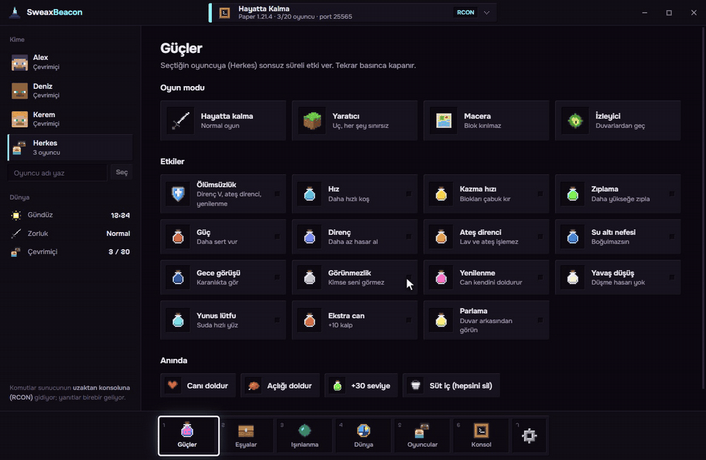
</p>
<p align="center"><sub>The app's interface on its built-in demo worlds (the same ones as on the website), so no real server or player shows up. <a href="docs/media/tour.mp4">MP4</a></sub></p>

<br>

## What it is

SweaxBeacon is a Windows app for people who play Minecraft Java. Pick a player and press a button: Creative mode, an effect that lasts until you switch it off, a set of diamond tools, a trip to a saved place, daytime, Keep Inventory. It works on a server you run, on a server elsewhere that you have the RCON password for, in a LAN world, and in single-player.

There is no account, no login and no connect screen. When it opens, it looks for Minecraft on the PC and links to what it finds. It asks for something only when nothing else can work, and then it is one button.

- **It finds your worlds.** Running servers are found from their Java process and its folder, server folders on the disk are found by their `server.properties`, and an open Minecraft window is found from the game's own command line, whichever launcher started it.
- **Single-player works.** There is no remote console in single-player, so SweaxBeacon types into the game's chat instead: it sends window messages to the Minecraft window only, never through the keyboard, and the game stays in the background with its pause menu. The game's replies are read from its own log.
- **It sets up the server for you.** RCON off? One button writes it into `server.properties` with a random password. Server not running? One button starts it in its own console window, the same as its start script would.
- **It shows the world as it is.** Effects that are on glow, the current game mode is marked, the clock, difficulty and game rules are read back from the server or from the world's `level.dat`.

<br>

## Every way into a world, picked for you

| What is on this PC | How SweaxBeacon gets in | What you do |
| --- | --- | --- |
| A server with RCON on | its remote console; the password comes from `server.properties` | nothing |
| A running server with RCON off | writes `enable-rcon`, a free `rcon.port` and a random `rcon.password` | restart the server once |
| A server folder that is not running | starts it in its own window, with RCON prepared | accept Mojang's EULA the first time |
| Minecraft in a single-player world | the game's chat, typed into the background window | cheats on: **Esc → Open to LAN → Allow Cheats: ON** |
| Minecraft in a LAN world or on a server where you are an operator | the game's chat | nothing |
| A server on another computer or a host | RCON with the address, port and password you enter once | fill in one form |

If Minecraft is open and connected to a server on this PC that has RCON, SweaxBeacon uses the server's RCON, which gives exact replies for every player. The last world you used is opened again next time.

<br>

## One click instead of a connect screen

<p align="center">
  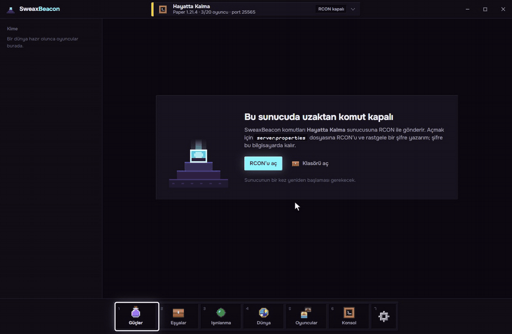
</p>

<table>
<tr>
<td width="33%" valign="top">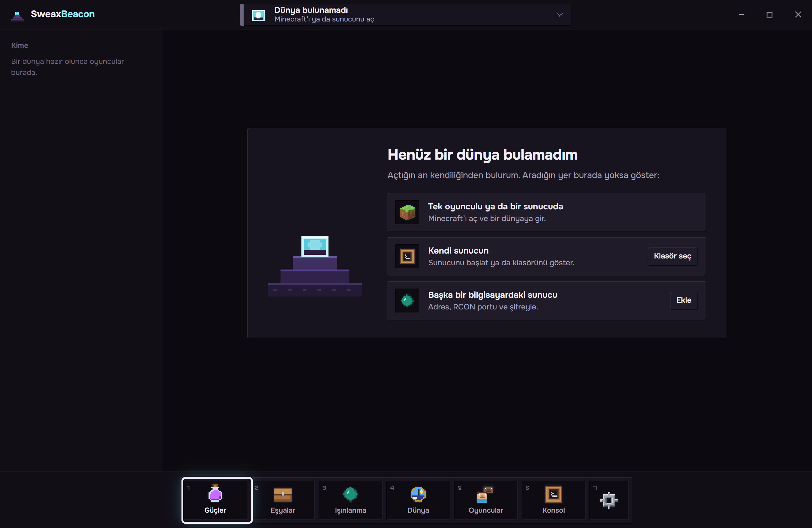<br><b>Nothing found.</b> Open Minecraft or a server and it appears by itself; a server folder elsewhere can be shown once, and a server on another machine can be added with its RCON password.</td>
<td width="33%" valign="top">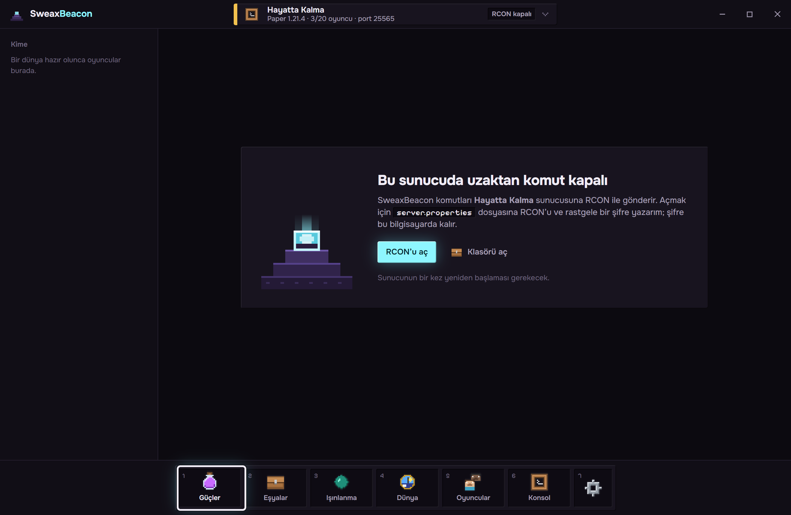<br><b>RCON is off.</b> One button writes it into <code>server.properties</code> with a 24-character random password and a free port. The password never leaves the PC.</td>
<td width="33%" valign="top">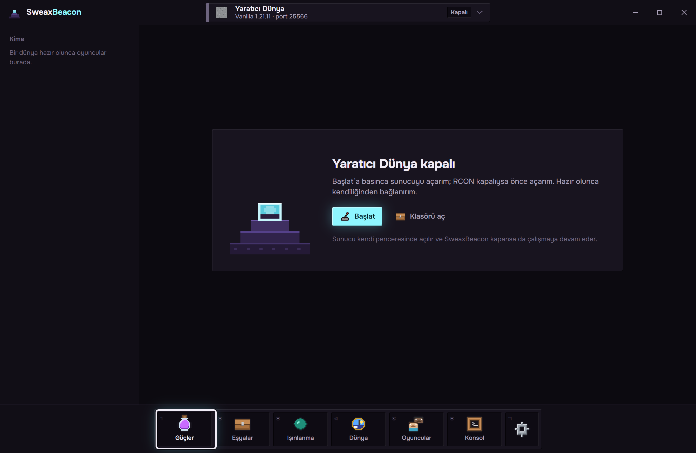<br><b>The server is off.</b> Start runs its own start script if it has one, otherwise its jar with a Java that fits its version, in a console window that keeps running after SweaxBeacon closes.</td>
</tr>
</table>

<br>

## Single-player

<p align="center">
  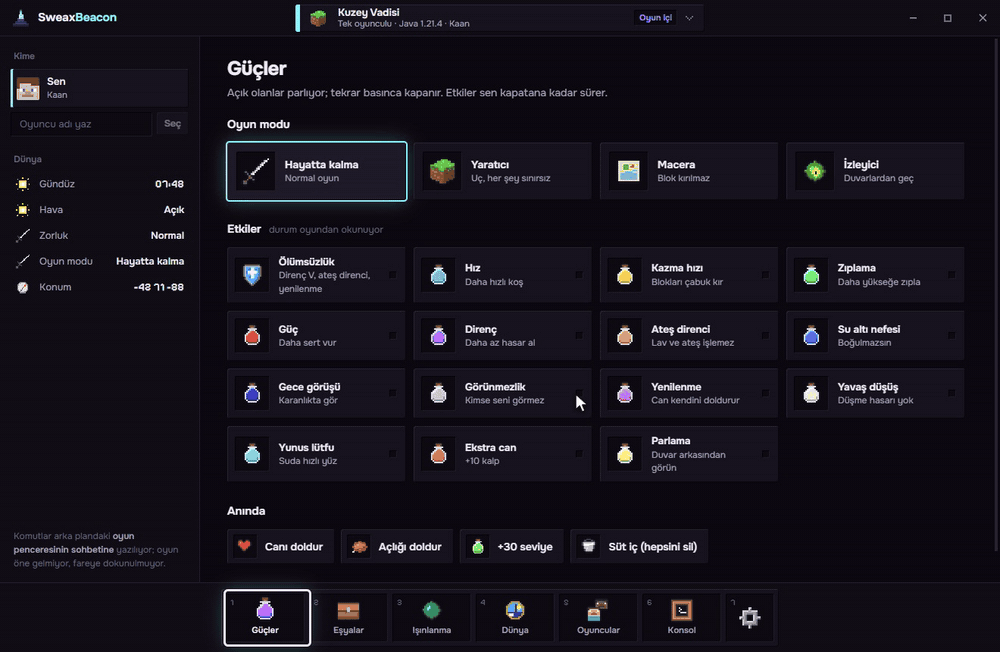
</p>

When Minecraft is open, SweaxBeacon shows the world you are in by name, with *In game* next to it. The buttons are the same as on a server. Each command is typed into the game's chat while the game sits behind SweaxBeacon with its pause menu:

<picture>
  <source media="(prefers-color-scheme: dark)" srcset="docs/art/sequence-en-dark.svg">
  
</picture>

- **Only the game window hears it.** The keys and the text are window messages posted to the Minecraft window ([`native/SweaxHelper.cs`](native/SweaxHelper.cs)). Nothing goes through the system keyboard, so typing in another window is never disturbed; the game is not brought to the front and the mouse is never moved.
- **It checks before and after.** It waits until a world that just loaded has shown its pause menu once, reads the chat key from `options.txt` (any keyboard key works), and stops a batch if the game does not answer. In single-player it confirms the pause menu is back from the log line `Saving and pausing game...` before it lets go of the window.
- **Replies in your language.** Replies come from the game's `logs/latest.log`. They are matched with patterns built from your own game's language file, so *Unknown or incomplete command* is recognised in Turkish too, and SweaxBeacon then tells you how to switch cheats on.
- **The world state comes from the save.** Minecraft writes `level.dat` every time it pauses, which is also how each batch ends; the app reads the player's game mode, effects and position, the time, the weather, the difficulty and the game rules from it.

Two things are needed in the game: cheats (**Esc → Open to LAN → Allow Cheats: ON → Start LAN World**, or a world created with cheats), and *Pause on lost focus*, which is on unless you switched it off with <kbd>F3</kbd>+<kbd>P</kbd>. SweaxBeacon says so when either is missing.

<br>

## What you can do

<table>
<tr>
<td width="33%" valign="top">
<picture><source media="(prefers-color-scheme: dark)" srcset="docs/art/tile-powers-dark.svg"></picture>
<h3>Powers</h3>
<p>The four game modes, Immortality (Resistance V, Fire Resistance, Regeneration III) and fourteen effects that last until you switch them off: Speed, Haste, Jump, Strength, Resistance, Fire Resistance, Water Breathing, Night Vision, Invisibility, Regeneration, Slow Falling, Dolphin's Grace, Health Boost, Glowing. Press again to switch one off. Plus full health, full food, 30 levels and a bucket of milk.</p>
</td>
<td width="33%" valign="top">
<picture><source media="(prefers-color-scheme: dark)" srcset="docs/art/tile-items-dark.svg"></picture>
<h3>Items</h3>
<p>Sixteen ready sets, from diamond tools to an elytra with 64 rockets, and a search over all 1,504 items of Java 1.21.11 in English or in your game's language (<i>elmas kılıç</i> finds <code>diamond_sword</code>), with 1, 16, 32, 64 or any amount up to 6,400.</p>
</td>
<td width="33%" valign="top">
<picture><source media="(prefers-color-scheme: dark)" srcset="docs/art/tile-teleport-dark.svg"></picture>
<h3>Teleport</h3>
<p>Save the place you stand on with a name and go back with one click, in the right dimension. Go to coordinates, to the world spawn, up to the surface when stuck in a cave, 50 blocks up, to another player, or bring a player to you.</p>
</td>
</tr>
<tr>
<td width="33%" valign="top">
<picture><source media="(prefers-color-scheme: dark)" srcset="docs/art/tile-world-dark.svg"></picture>
<h3>World</h3>
<p>A day dial with morning, noon, evening and night; clear, rain or thunder; the four difficulties; twelve game rules as switches that show their real state; and a fill tool with "this is a corner" buttons. Game rule names follow the version: <code>keepInventory</code> before 1.21.11, <code>keep_inventory</code> from 1.21.11 on.</p>
</td>
<td width="33%" valign="top">
<picture><source media="(prefers-color-scheme: dark)" srcset="docs/art/tile-players-dark.svg"></picture>
<h3>Players</h3>
<p>Everyone online with a pixel face made from their name. Pick who the buttons act on (one player, everyone, or a name you type), make operators, kick, ban, send a message to everyone, and run the whitelist.</p>
</td>
<td width="33%" valign="top">
<picture><source media="(prefers-color-scheme: dark)" srcset="docs/art/tile-console-dark.svg"></picture>
<h3>Console</h3>
<p>Any command, with history on <kbd>↑</kbd> <kbd>↓</kbd> and <code>{t}</code> standing for the chosen player. Every button's commands and every reply are listed here with the time; the last few also show up at the bottom left, like game chat.</p>
</td>
</tr>
</table>

<br>

## Screens

<p align="center">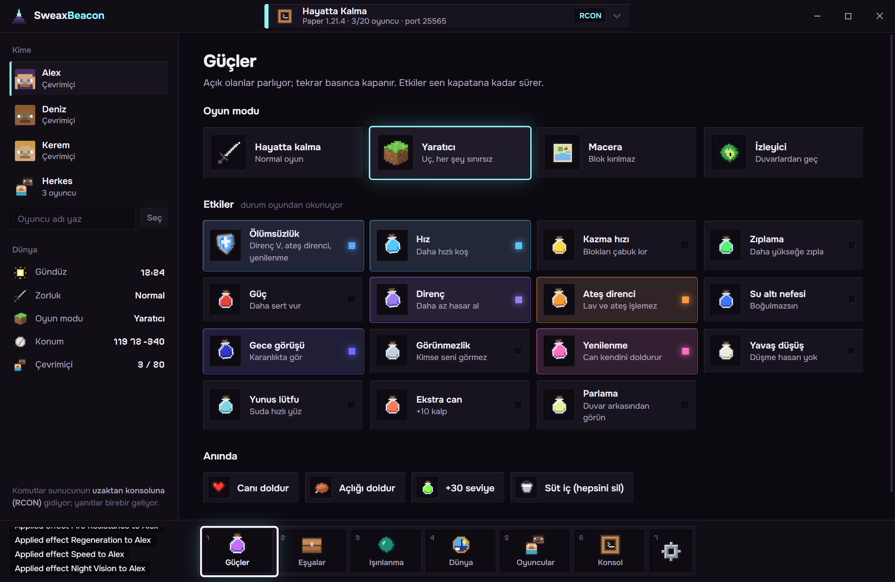</p>

<table>
<tr>
<td width="50%">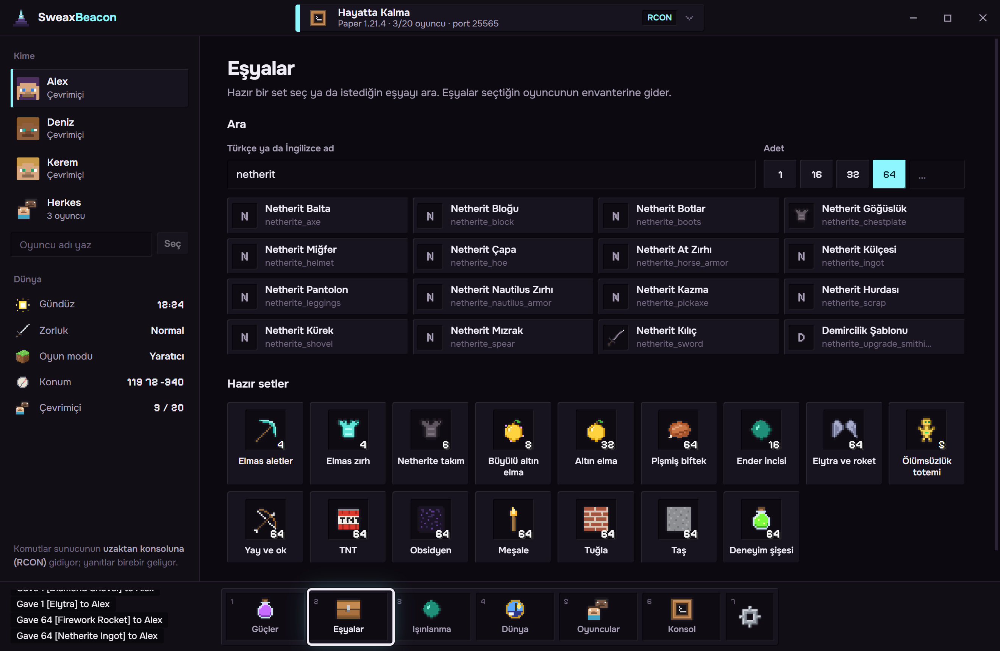</td>
<td width="50%">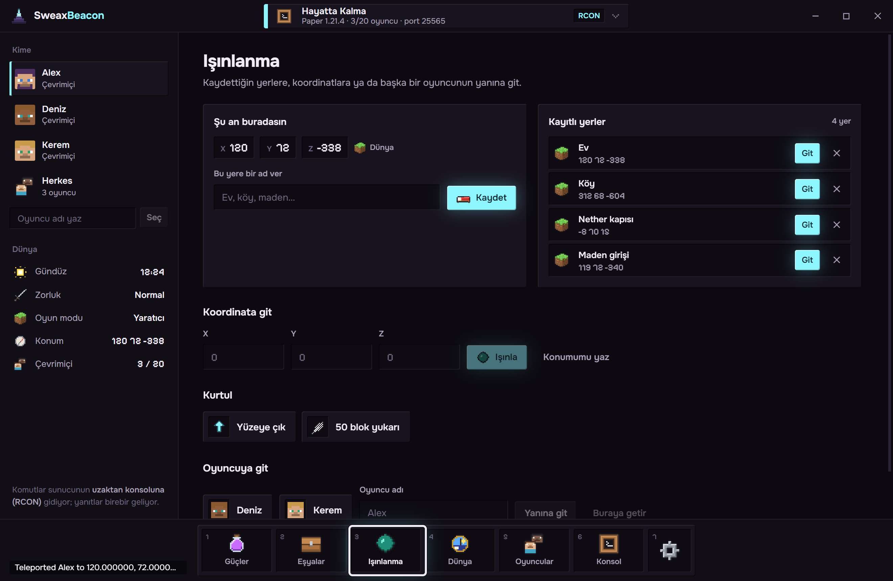</td>
</tr>
<tr>
<td>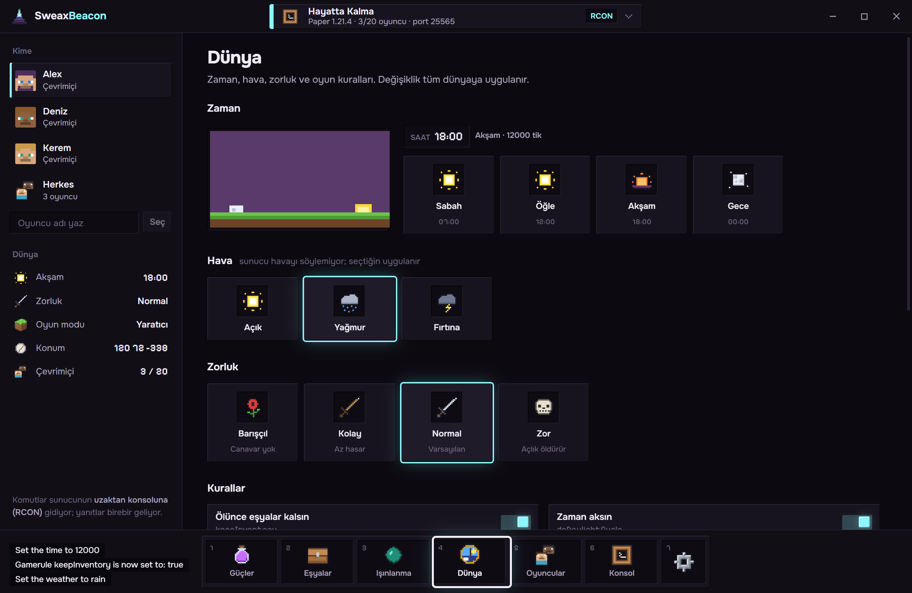</td>
<td>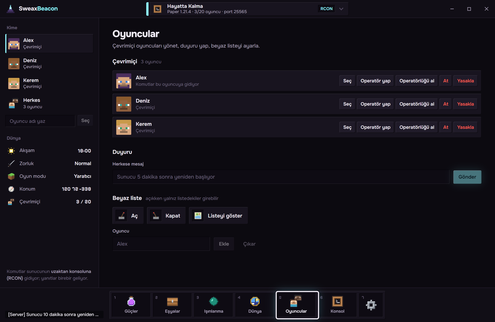</td>
</tr>
<tr>
<td>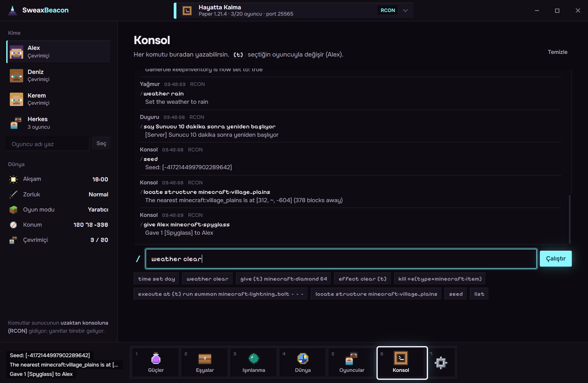</td>
<td>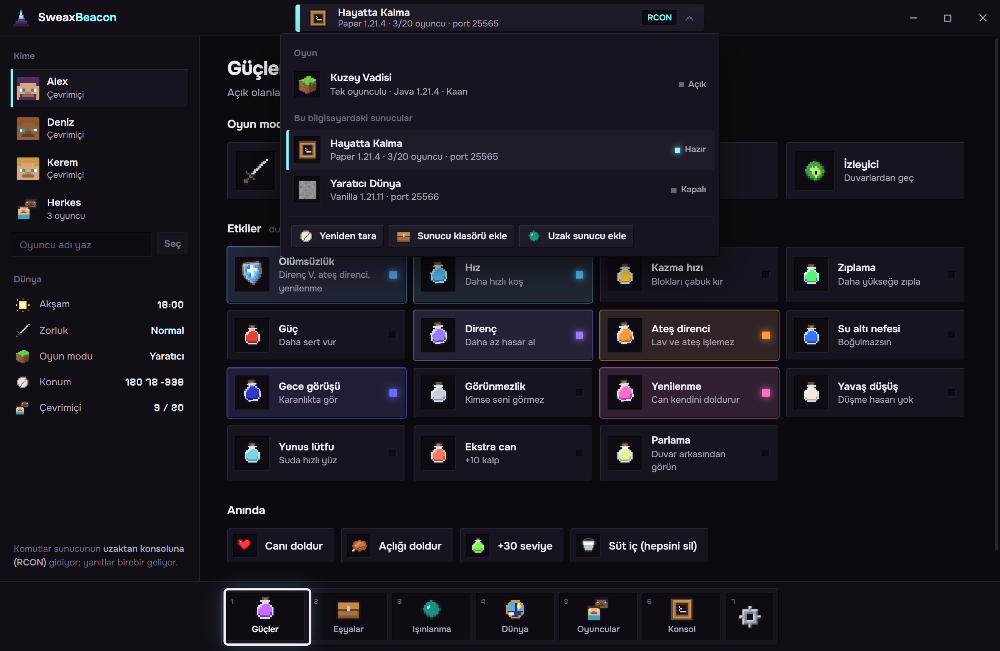</td>
</tr>
<tr>
<td>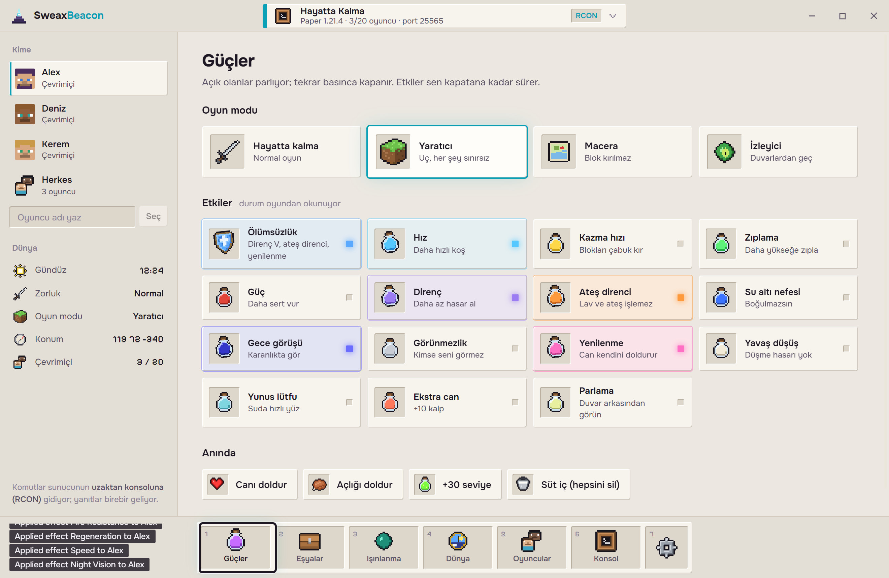</td>
<td>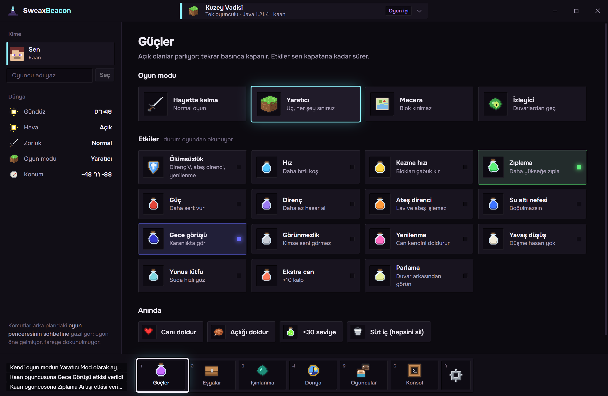</td>
</tr>
</table>

The look comes from the beacon block, the thing in Minecraft that gives powers to players around it: surfaces are blocks with a light top edge and a dark bottom edge, item slots are pressed in like an inventory, the one accent colour is beacon light, and each effect keeps its potion colour. The pages are switched from a hotbar (keys <kbd>1</kbd> to <kbd>7</kbd>); the selection frame springs to the slot and the page's name shows above it for a moment, the way the game shows an item's name. Every icon is drawn by [`tools/pixel_icons.py`](tools/pixel_icons.py); nothing is taken from the game. Two themes, Obsidian and Quartz, or follow Windows.

<br>

## How it works

<picture>
  <source media="(prefers-color-scheme: dark)" srcset="docs/art/architecture-en-dark.svg">
  
</picture>

**Finding worlds.** Every few seconds [`electron/mc/discover.cjs`](electron/mc/discover.cjs) asks the helper for every `java.exe` and `javaw.exe` with its command line and working folder (read from the process environment block, which needs no admin rights). A process whose folder holds `server.properties` is a server; its listening ports come from `netstat`, and a Server List Ping on its game port gives the version, the player count and its icon. A process started with `net.minecraft.client.main.Main`, a Fabric, Quilt, Forge or NeoForge client, or a launcher such as Prism is a game; `--gameDir`, `--username` and `--version` come from its command line, `options.txt` from its folder. Server folders that are not running are found by a short scan of the usual places (Desktop, Documents, Downloads and the top of each drive) when the app starts, and remembered.

**RCON.** [`electron/mc/rcon.cjs`](electron/mc/rcon.cjs) is the Source RCON protocol with Node's `net` module only. Minecraft drops a connection whose read holds more than one packet, so every packet goes out on its own; long replies, which the server splits into 4 KB packets, are joined by sending an unknown packet type after the first piece and waiting for the server's "Unknown request" answer to it.

**The game window.** [`electron/mc/links.cjs`](electron/mc/links.cjs) decides the steps and watches `latest.log` between them; [`native/SweaxHelper.cs`](native/SweaxHelper.cs), a 12 KB C# program compiled with the compiler that ships with Windows, posts the messages. The open single-player world is the one whose `session.lock` the game holds; its `level.dat` is read with the NBT reader in [`electron/mc/nbt.cjs`](electron/mc/nbt.cjs).

**The window.** React with no Node access (`contextIsolation` on): it talks to the main process through the functions in [`electron/preload.cjs`](electron/preload.cjs). Passwords of remote servers are encrypted with Windows DPAPI (Electron `safeStorage`); local servers need none, their password stays in their own `server.properties`.

<br>

## Tested with

Each of these ran on this PC; the scripts are in [`tools/test/`](tools/test).

| What | How | Result |
| --- | --- | --- |
| Finding, setting up and linking to a server | [`server-test.cjs`](tools/test/server-test.cjs) against Paper 1.21.4 with RCON off: found from its process, RCON switched on, server stopped, started again with SweaxBeacon's Start, linked, commands run | 20 of 20 checks pass |
| RCON details | the same script: `list`, `difficulty`, `time`, `gamerule`, `weather`, an unknown player, an 8,232-character reply over three packets, a wrong password | pass |
| Java 1.21.11 game rule names | RCON against Paper 1.21.11; the app linked to it with no setup and showed the `keep_inventory` names and states | pass |
| Single-player through the chat | [`chat-link-test.cjs`](tools/test/chat-link-test.cjs) against the official Minecraft 1.21.4 client in a test world: game mode, time, effect, give, game rule, teleport, list, a wrong command, then `level.dat` read back; the mouse, the mouse clip and the foreground window sampled every 25 ms the whole time | all checks pass |
| Cheats off | the same script in a world without cheats | detected and explained |
| The whole app on a single-player world | [`app-chat-e2e.cjs`](tools/test/app-chat-e2e.cjs): the app found the running 1.21.4 game by itself and linked to it; Speed and noon applied from its buttons and read back from `level.dat` | linked; later runs blocked, see below |
| Minecraft 1.20.1 | finding the client, its folder, window, options and open world | pass |

Notes: the full chat-link runs above passed before the last change to the chat link, which only adds the wait for a freshly loaded world. In later runs on this PC, the test clients (1.21.4 and 1.20.1, started off screen) stayed on the game's own loading screen after joining, with an OpenGL error in their log. SweaxBeacon then refused to type, as designed ("the world is still loading"), so typing into 1.20.1 was not shown here. The single-player path needs Minecraft's *Pause on lost focus*, which is on by default.

<br>

## Install

1. Download **`SweaxBeacon-Kurulum-2.0.0.exe`** from the [latest release](https://github.com/Sweax3169/sweaxbeacon/releases/latest). Windows 10 or 11, 64-bit.
2. Run it. It installs for your user only into `%LOCALAPPDATA%\Programs\sweaxbeacon`, adds Desktop and Start menu shortcuts, and opens the app.
3. The installer is not code-signed, so Windows SmartScreen may say *Windows protected your PC*. Choose **More info → Run anyway**.

SweaxPanel 1.x is the same app under its old name; uninstall it from **Settings → Apps**. Settings are kept in `%APPDATA%\SweaxBeacon\settings.json`: remembered server folders, servers you added (passwords encrypted), saved places and the theme.

<br>

## Build from source

Node.js 20 or newer, on Windows.

```powershell
git clone https://github.com/Sweax3169/sweaxbeacon.git
cd sweaxbeacon
npm ci

npm run dev            # the interface in a browser on its demo worlds (src/mockApi.js)
npm run build:helper   # native/bin/sweax-helper.exe from native/SweaxHelper.cs
npm run build:renderer # the interface into dist/
npm start              # the real app in Electron
npm run dist           # helper + interface + installer into release/
```

<details>
<summary><b>Tests, screenshots, recordings and artwork</b></summary>

```powershell
npm run test:server -- --dir=<a server folder with RCON off> --version=1.21.4
node tools/test/fetch-client.cjs 1.21.4 <folder>          # official client and server jars from Mojang, for the next two
npm run test:chat -- --client=<folder> --game=<game folder> --world=<world>
node tools/test/app-chat-e2e.cjs --client=<folder> --game=<game folder> --world=<world>

npx electron tools/media/capture.cjs --scene=stills       # docs/media/*.png on the demo worlds
npx electron tools/media/capture.cjs --scene=tour         # also single, setup; then:
node tools/media/encode-film.cjs --name=tour              # docs/media/tour.mp4 and tour.gif (needs ffmpeg)
python tools/pixel_icons.py                               # src/pixel/icons.json
python tools/art.py                                       # docs/art/*.svg (needs fontTools and brotli)
```

The game tests start the client through WMI so it cannot take focus, move its window below every monitor, and give the foreground straight back if Windows hands it to the new window; the capture script keeps SweaxBeacon's window off screen and points its settings at a temporary folder.
</details>

<br>

## Project layout

```
electron/
  main.cjs            window, IPC, settings, DPAPI for remote passwords
  preload.cjs         the window.beacon bridge
  sessions.cjs        the list of worlds, choosing one, keeping one link open
  mc/discover.cjs     servers and games on this PC
  mc/links.cjs        RconLink and ChatLink
  mc/rcon.cjs         Source RCON client
  mc/game.cjs         keys, language patterns, latest.log, open world, level.dat
  mc/servers.cjs      switch RCON on, accept the EULA, find Java, start a server
  mc/props.cjs        server.properties, edited in place
  mc/slp.cjs          Server List Ping
  mc/nbt.cjs          NBT reader
  mc/names.cjs        item names from the player's own language file
  sys/helper.cjs      talks to sweax-helper.exe
  sys/netstat.cjs     listening ports per process
native/SweaxHelper.cs processes, windows and window messages (C# 5)
src/
  App.jsx             links, live state, running commands
  components/         title bar and world switcher, rail, hotbar, gates, feed
  sections/           Powers, Items, Teleport, World, Players, Console, Settings
  data/catalog.js     every button and the commands it sends
  pixel/              icons.json and the canvas renderer, generated faces
  mockApi.js          the demo worlds
tools/                art.py, pixel_icons.py, build-helper.cjs, media/, test/
docs/                 website (GitHub Pages), media, artwork, fonts
```

<br>

## Privacy

SweaxBeacon makes no connection to the internet: no account, no telemetry, no update check. It connects to Minecraft servers you pick or that run on this PC, and reads files of Minecraft installations on this PC (`server.properties`, `options.txt`, `latest.log`, `level.dat`, the launcher's language file). It writes to a server folder only when you press a button that says so (RCON, EULA).

<br>

## Questions

<details>
<summary><b>Does it work on other people's servers?</b></summary>

Over RCON only with that server's password. Through the game's chat only where the server lets you run commands, which means you are an operator there. It sends the same commands you could type yourself; it does not change the game.
</details>

<details>
<summary><b>Which versions?</b></summary>

Java Edition. Effects that last forever use <code>effect … infinite</code>, which needs 1.19.4 or newer; the tests ran on 1.21.4 and 1.21.11 servers and a 1.21.4 client, and finding a 1.20.1 client worked. Servers: vanilla, Paper, Purpur, Spigot, Fabric, Forge and NeoForge are recognised. Bedrock has neither RCON nor this chat, so it does not work.
</details>

<details>
<summary><b>The buttons do nothing in single-player.</b></summary>

The game answers <i>Unknown or incomplete command</i> when cheats are off; SweaxBeacon then shows how to switch them on. If it says the world is still loading, wait until you are in the world. If it asks for F3+P, <i>Pause on lost focus</i> was switched off.
</details>

<details>
<summary><b>Why does the server need a restart after RCON is switched on?</b></summary>

A Minecraft server reads <code>server.properties</code> only when it starts. SweaxBeacon writes the setting and links to the server by itself as soon as it is back.
</details>

<details>
<summary><b>Is RCON safe?</b></summary>

RCON is not encrypted, so keep its port off the internet: do not forward it on your router. The password SweaxBeacon writes is 24 random characters.
</details>

<br>

## Credits

Built with [Electron](https://www.electronjs.org/), [React](https://react.dev/) and [Vite](https://vite.dev/), packaged with [electron-builder](https://www.electron.build/). Type: [Onest](https://github.com/simpals/onest) and [Pixelify Sans](https://github.com/eifetx/Pixelify-Sans). Details in [THIRD_PARTY_NOTICES.md](THIRD_PARTY_NOTICES.md).

MIT licensed. © 2026 Sweax Studios.

<sub>SweaxBeacon is not an official Minecraft product and is not approved by or associated with Mojang or Microsoft.</sub>
