<a href="https://sweax3169.github.io/sweaxpanel/">
  <picture>
    <source media="(prefers-color-scheme: dark)" srcset="docs/art/banner-en-dark.svg">
    
  </picture>
</a>

<p align="center">
  <a href="https://github.com/Sweax3169/sweaxpanel/releases/latest"><b>Download for Windows</b></a>
  &nbsp;&nbsp;·&nbsp;&nbsp;
  <a href="https://sweax3169.github.io/sweaxpanel/">Website</a>
  &nbsp;&nbsp;·&nbsp;&nbsp;
  <a href="#set-up-rcon-on-your-server">Set up RCON</a>
  &nbsp;&nbsp;·&nbsp;&nbsp;
  <a href="README.tr.md">Türkçe</a>
</p>

<p align="center">
  <a href="https://github.com/Sweax3169/sweaxpanel/releases/latest"></a>
  
  
  
  <a href="LICENSE"></a>
</p>

<br>

<p align="center">
  
</p>
<p align="center"><sub>Recorded from the real app, connected to a local stand-in server. Password, connect, then one click in each tab; every command and reply lands in the log at the bottom. <a href="docs/media/demo.mp4">MP4</a></sub></p>

<br>

## What it is

SweaxPanel is a Windows desktop app for the person who runs a Minecraft Java server. It connects to the server's **RCON** port, the remote console built into the server, and turns the commands you would otherwise type into buttons: give a player Creative mode or an effect that never runs out, hand out a set of diamond tools, teleport someone out of a hole, switch off mob griefing, op a friend, or type any command yourself.

It is an admin tool for a server you control. It does not touch the game client, inject anything or get around anti-cheat. It can only connect to a server whose RCON is switched on and whose password you have, which in practice means a server you run.

- **Six tabs.** Powers, Items, Teleport, World, Players and Console, plus a target-player picker filled from the server's player list.
- **Everything is logged.** Each command and the server's reply appears in the log under the tabs, with the time.
- **No dependencies for the protocol.** The RCON client is 162 lines in [`electron/rcon.cjs`](electron/rcon.cjs) and uses only Node's `net` module.
- **Interface language: Turkish.** Buttons, labels and error messages are in Turkish for now. The commands it sends are ordinary Minecraft commands.

<br>

## The six tabs

<table>
<tr>
<td width="33%" valign="top">
<picture><source media="(prefers-color-scheme: dark)" srcset="docs/art/tile-powers-dark.svg"></picture>
<h3>Powers <sub>Güçler</sub></h3>
<p>Fifteen buttons for the selected player. Creative, Survival and Spectator mode; effects that never run out: speed III, haste III, jump boost IV, night vision, water breathing, strength II, invisibility, regeneration; instant health, food, and clear all effects.</p>
<p>One button can send several commands. <b>Immortality</b> sends three: resistance V, fire resistance and regeneration III.</p>
<pre>gamemode creative {t}
effect give {t} speed infinite 2 true</pre>
</td>
<td width="33%" valign="top">
<picture><source media="(prefers-color-scheme: dark)" srcset="docs/art/tile-items-dark.svg"></picture>
<h3>Items <sub>Eşya</sub></h3>
<p>Twelve ready-made bundles: diamond tools, diamond armour, a netherite sword, 16 enchanted golden apples, 64 cooked beef, 16 ender pearls, an elytra, 5 totems, 64 TNT, 64 obsidian, 64 torches, a bow with 64 arrows.</p>
<p>Or type any item id and an amount from 1 to 6400.</p>
<pre>give {t} minecraft:diamond_pickaxe
give {t} minecraft:netherite_ingot 16</pre>
</td>
<td width="33%" valign="top">
<picture><source media="(prefers-color-scheme: dark)" srcset="docs/art/tile-teleport-dark.svg"></picture>
<h3>Teleport <sub>Işınlanma</sub></h3>
<p>Send the target to exact coordinates, 50 blocks straight up when they are stuck, or up to Y 250. Send the target to another player, or bring that player to the target.</p>
<pre>tp {t} 120 72 -340
tp {t} ~ ~50 ~
tp {t} Alex</pre>
</td>
</tr>
<tr>
<td width="33%" valign="top">
<picture><source media="(prefers-color-scheme: dark)" srcset="docs/art/tile-world-dark.svg"></picture>
<h3>World <sub>Dünya</sub></h3>
<p>Time (day, noon, night, midnight), weather (clear, rain, thunder) and difficulty. Nine game rules as switches; when the tab opens it asks the server for each rule's current value. Fill a box between two corners with any block, or clear it to air.</p>
<pre>time set day
gamerule keepInventory true
fill x1 y1 z1 x2 y2 z2 minecraft:stone</pre>
</td>
<td width="33%" valign="top">
<picture><source media="(prefers-color-scheme: dark)" srcset="docs/art/tile-players-dark.svg"></picture>
<h3>Players <sub>Oyuncular</sub></h3>
<p>Everyone online, read from <code>list</code>. Per player: make target, op, deop, Creative, kick, ban. A message to the whole server. The whitelist: on, off, show, add, remove.</p>
<pre>op Alex
say Restart in 10 minutes
whitelist add Alex</pre>
</td>
<td width="33%" valign="top">
<picture><source media="(prefers-color-scheme: dark)" srcset="docs/art/tile-console-dark.svg"></picture>
<h3>Console <sub>Konsol</sub></h3>
<p>Type any server command, including plugin commands, and press <kbd>Enter</kbd>. A leading <code>/</code> is removed. <code>{t}</code> is replaced with the selected player.</p>
<pre>seed
give {t} minecraft:spyglass
  → give Steve minecraft:spyglass</pre>
</td>
</tr>
</table>

`{t}` in the commands above stands for the target player picked in the sidebar. A button that needs a target and has none shows a warning instead of sending anything.

<br>

## Screens

<table>
<tr>
<td width="50%"></td>
<td width="50%"></td>
</tr>
<tr>
<td align="center"><sub><b>Connect.</b> Address, RCON port and password, with the server.properties lines next to it.</sub></td>
<td align="center"><sub><b>Powers.</b> Steve is the target; each reply from the server is in the log.</sub></td>
</tr>
<tr>
<td width="50%"></td>
<td width="50%"></td>
</tr>
<tr>
<td align="center"><sub><b>Items.</b> Bundles, then 16 netherite ingots from the custom field.</sub></td>
<td align="center"><sub><b>Teleport.</b> To coordinates, 50 blocks up, then to Alex.</sub></td>
</tr>
<tr>
<td width="50%"></td>
<td width="50%"></td>
</tr>
<tr>
<td align="center"><sub><b>World.</b> Switches show the values the server reported.</sub></td>
<td align="center"><sub><b>Players.</b> Op Alex, broadcast a message, list the whitelist.</sub></td>
</tr>
<tr>
<td width="50%"></td>
<td width="50%" valign="middle"><sub>The screenshots and the recording are of the real app (the same <code>electron/main.cjs</code>, preload and RCON client), driven through the Chrome DevTools Protocol by <a href="tools/media/capture.cjs"><code>tools/media/capture.cjs</code></a>. The server on the other end is <a href="tools/media/fake-rcon-server.cjs"><code>tools/media/fake-rcon-server.cjs</code></a>, a small stand-in that speaks RCON and answers the way a Paper server does, so no real server or player data appears. Steve and Alex are example names.</sub></td>
</tr>
<tr>
<td align="center"><sub><b>Console.</b> <code>{t}</code> became Steve in the last command.</sub></td>
<td></td>
</tr>
</table>

<br>

## How a button press reaches the server

<picture>
  <source media="(prefers-color-scheme: dark)" srcset="docs/art/architecture-en-dark.svg">
  
</picture>

The window has no Node access (`contextIsolation` on, `nodeIntegration` off). It can only call the eight functions the preload script exposes as `window.sweax`: connect, command, disconnect, status, read and save settings, the window buttons, and a notice when the connection drops. The main process keeps a single RCON connection. Connecting times out after 8 seconds and each command after 6. Colour codes (`§a`, `§6`…) are stripped from replies before they are shown.

<picture>
  <source media="(prefers-color-scheme: dark)" srcset="docs/art/packet-en-dark.svg">
  
</picture>

RCON is the Source RCON protocol. After the TCP connection opens, the client sends a login packet (type 3) with the password; the server answers with the same request id, or with id −1 if the password is wrong. Every command after that is a type 2 packet, and the reply is a type 0 packet with the same id. [`electron/rcon.cjs`](electron/rcon.cjs) builds these frames, collects replies that arrive split over several TCP reads, and matches each reply to its command by id.

<br>

## Set up RCON on your server

Stop the server, open `server.properties` in the server folder, set these three lines, and start it again:

```properties
enable-rcon=true
rcon.port=25575
rcon.password=use-a-long-random-password-here
```

Then open SweaxPanel and connect with:

| Field | Server on the same PC | Server elsewhere |
| --- | --- | --- |
| Address | `localhost` | the server's IP or host name |
| RCON port | `25575` (or your `rcon.port`) | the same |
| Password | your `rcon.password` | the same |

> [!WARNING]
> **RCON is not encrypted.** The password and every command travel as plain bytes, and anyone with the password has full console access to the server. Use a long random password. Keep the RCON port off the internet: do not forward it on your router, and allow it in the firewall only for the computer you run SweaxPanel on. If the server runs on the same PC, connect to `localhost`.

**Remember password.** If you tick it, the password is saved in plain text, together with the address and port, in `%APPDATA%\SweaxPanel\sweaxpanel-settings.json`. Leave it unticked on a shared computer. Without the tick only the address and port are saved.

SweaxPanel makes no other network connections: no accounts, no telemetry, no update checks.

<br>

## Install

1. Download **`SweaxPanel-Kurulum-1.0.0.exe`** from the [latest release](https://github.com/Sweax3169/sweaxpanel/releases/latest). Windows 10 or 11, 64-bit.
2. Run it. It is a one-click installer: it installs for your user only into `%LOCALAPPDATA%\Programs\SweaxPanel`, adds Desktop and Start menu shortcuts, and opens the app.
3. The installer is not code-signed, so Windows SmartScreen may say *Windows protected your PC*. Choose **More info → Run anyway**.

To remove it, use **Settings → Apps**. Your saved connection settings in `%APPDATA%\SweaxPanel` stay until you delete that folder.

<br>

## Build from source

You need Node.js 20 or newer, and Windows for the installer.

```powershell
git clone https://github.com/Sweax3169/sweaxpanel.git
cd sweaxpanel
npm ci

npm run dev               # the interface in a browser at http://localhost:5210, with a fake RCON (src/mockApi.js)
npm run build:renderer    # build the interface into dist/
npm start                 # run it in Electron (loads dist/)
npm run dist              # build dist/ and the installer into release/
```

To run Electron against the Vite dev server instead of `dist/`, set `SWEAXPANEL_DEV_URL` first: `$env:SWEAXPANEL_DEV_URL = "http://localhost:5210"; npm start`.

<details>
<summary><b>Regenerating the screenshots, the recording and the artwork</b></summary>

```powershell
npx vite build
npx electron tools/media/capture.cjs    # starts the stand-in server on port 25575, saves docs/media/*.png and screencast frames
node tools/media/encode-film.cjs        # frames -> docs/media/demo.mp4 and demo.gif (needs ffmpeg)
python tools/art.py                     # docs/art/*.svg (needs fontTools, brotli, Pillow)
```

`capture.cjs` loads the app's own `electron/main.cjs`, keeps the window off screen without taking focus, and points the app's data folder at a temporary folder, so it never reads or changes a real installation's settings.
</details>

<br>

## Project layout

```
electron/
  main.cjs          window, IPC handlers, settings file
  preload.cjs       the window.sweax bridge
  rcon.cjs          Source RCON client (Node net only)
src/
  App.jsx           connection state, command runner, log
  commands.js       every button and the commands it sends ({t} = target)
  components/       ConnectScreen, Sidebar, Sections (the six tabs), LogPanel, TitleBar
  mockApi.js        fake window.sweax for npm run dev in a browser
build/              app icon and its generator (make-icon.mjs)
docs/               website (GitHub Pages), screenshots, artwork, fonts
tools/              art.py, media/capture.cjs, media/fake-rcon-server.cjs, media/encode-film.cjs
```

<br>

## Questions

<details>
<summary><b>Can I use it on someone else's server?</b></summary>

Only with that server's RCON password, which only the people running it have. SweaxPanel talks to the server's own remote console; it does nothing on the game client.
</details>

<details>
<summary><b>Which servers and versions work?</b></summary>

Java Edition servers with RCON switched on: vanilla, and servers built on it such as Paper, Spigot, Fabric or Forge. It was tested against Paper 1.21.4. The Powers tab uses <code>effect … infinite</code>, which needs Java Edition 1.19.4 or newer; on older versions the server rejects those buttons and the rest keep working. Bedrock Dedicated Server has no RCON, so it does not work there.
</details>

<details>
<summary><b>My host gives me a web control panel. Does it work with that?</b></summary>

If your host lets you switch RCON on and gives you an address, port and password, enter those. Some hosts do not expose RCON at all.
</details>

<details>
<summary><b>The connection fails. What should I check?</b></summary>

SweaxPanel shows the reason: the server could not be reached (server off, or wrong port), the connection timed out (wrong address, or a firewall), the host name was not found, the password was wrong, or the server closed the connection (RCON not enabled). After changing <code>server.properties</code> the server has to be restarted.
</details>

<details>
<summary><b>macOS or Linux?</b></summary>

Only the Windows installer is built and tested.
</details>

<br>

## Credits

Built with [Electron](https://www.electronjs.org/), [React](https://react.dev/) and [Vite](https://vite.dev/), packaged with [electron-builder](https://www.electron.build/). The wire format is Valve's [Source RCON protocol](https://developer.valvesoftware.com/wiki/Source_RCON_Protocol), which Minecraft servers use. The website and artwork use [Instrument Sans](https://github.com/Instrument/instrument-sans) and [Martian Mono](https://github.com/evilmartians/mono). Details in [THIRD_PARTY_NOTICES.md](THIRD_PARTY_NOTICES.md).

MIT licensed. © 2026 Sweax Studios.

<sub>SweaxPanel is not an official Minecraft product and is not approved by or associated with Mojang or Microsoft.</sub>
