<a href="https://sweax3169.github.io/sweaxpanel/">
  <picture>
    <source media="(prefers-color-scheme: dark)" srcset="docs/art/banner-tr-dark.svg">
    
  </picture>
</a>

<p align="center">
  <a href="https://github.com/Sweax3169/sweaxpanel/releases/latest"><b>Windows için indir</b></a>
  &nbsp;&nbsp;·&nbsp;&nbsp;
  <a href="https://sweax3169.github.io/sweaxpanel/">Site</a>
  &nbsp;&nbsp;·&nbsp;&nbsp;
  <a href="#sunucuda-rconu-aç">RCON kurulumu</a>
  &nbsp;&nbsp;·&nbsp;&nbsp;
  <a href="README.md">English</a>
</p>

<p align="center">
  <a href="https://github.com/Sweax3169/sweaxpanel/releases/latest"></a>
  
  
  
  <a href="LICENSE"></a>
</p>

<br>

<p align="center">
  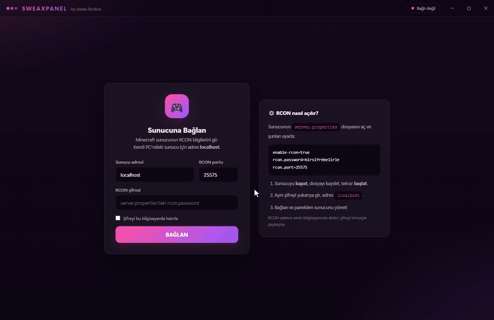
</p>
<p align="center"><sub>Gerçek uygulamadan kaydedildi; karşıda yerel bir yedek sunucu var. Şifre, bağlan, sonra her sekmede bir tık; her komut ve yanıt alttaki günlüğe düşüyor. <a href="docs/media/demo.mp4">MP4</a></sub></p>

<br>

## Ne işe yarar

SweaxPanel, Minecraft Java sunucusu çalıştıran kişi için bir Windows masaüstü uygulaması. Sunucunun içinde gelen uzak konsola, yani **RCON** portuna bağlanır ve normalde yazacağın komutları düğmeye çevirir: bir oyuncuya Creative ya da bitmeyen bir efekt ver, elmas alet seti dağıt, çukura düşeni yukarı ışınla, mob hasarını kapat, arkadaşını OP yap ya da istediğin komutu kendin yaz.

Kontrolü sende olan bir sunucu için yönetici aracıdır. Oyun istemcisine dokunmaz, bir şey enjekte etmez, anti-cheat atlatmaz. Yalnızca RCON'u açık olan ve şifresini bildiğin bir sunucuya bağlanabilir; bu da pratikte kendi çalıştırdığın sunucu demek.

- **Altı sekme.** Güçler, Eşya, Işınlanma, Dünya, Oyuncular ve Konsol; yanında sunucunun oyuncu listesinden dolan hedef oyuncu seçici.
- **Her şey günlüğe yazılır.** Her komut ve sunucunun yanıtı, saatiyle birlikte sekmelerin altındaki günlükte görünür.
- **Protokol için bağımlılık yok.** RCON istemcisi [`electron/rcon.cjs`](electron/rcon.cjs) içinde 162 satır ve yalnızca Node'un `net` modülünü kullanır.
- **Arayüz dili: Türkçe.** Düğmeler, etiketler ve hata mesajları Türkçe. Gönderilen komutlar sıradan Minecraft komutlarıdır.

<br>

## Altı sekme

<table>
<tr>
<td width="33%" valign="top">
<picture><source media="(prefers-color-scheme: dark)" srcset="docs/art/tile-powers-dark.svg"></picture>
<h3>Güçler</h3>
<p>Seçili oyuncu için on beş düğme. Creative, Survival ve Spectator; bitmeyen efektler: hız III, hızlı kazma III, zıplama IV, gece görüşü, su nefesi, güç II, görünmezlik, oto şifa; anında can, açlık doldurma ve tüm efektleri temizleme.</p>
<p>Bir düğme birden fazla komut gönderebilir. <b>Ölümsüzlük</b> üç tane gönderir: direnç V, ateş direnci ve yenilenme III.</p>
<pre>gamemode creative {t}
effect give {t} speed infinite 2 true</pre>
</td>
<td width="33%" valign="top">
<picture><source media="(prefers-color-scheme: dark)" srcset="docs/art/tile-items-dark.svg"></picture>
<h3>Eşya</h3>
<p>On iki hazır paket: elmas alet seti, elmas zırh seti, netherite kılıç, 16 büyülü altın elma, 64 pişmiş et, 16 ender incisi, elytra, 5 totem, 64 TNT, 64 obsidyen, 64 meşale, yay ve 64 ok.</p>
<p>Ya da herhangi bir eşya kodu ve 1 ile 6400 arası adet yaz.</p>
<pre>give {t} minecraft:diamond_pickaxe
give {t} minecraft:netherite_ingot 16</pre>
</td>
<td width="33%" valign="top">
<picture><source media="(prefers-color-scheme: dark)" srcset="docs/art/tile-teleport-dark.svg"></picture>
<h3>Işınlanma</h3>
<p>Hedefi tam koordinata, sıkıştığında 50 blok yukarı ya da Y 250'ye gönder. Hedefi başka bir oyuncuya ışınla ya da o oyuncuyu hedefin yanına getir.</p>
<pre>tp {t} 120 72 -340
tp {t} ~ ~50 ~
tp {t} Alex</pre>
</td>
</tr>
<tr>
<td width="33%" valign="top">
<picture><source media="(prefers-color-scheme: dark)" srcset="docs/art/tile-world-dark.svg"></picture>
<h3>Dünya</h3>
<p>Zaman (gündüz, öğle, akşam, gece), hava (açık, yağmur, fırtına) ve zorluk. Dokuz oyun kuralı anahtar olarak; sekme açılınca her kuralın o anki değerini sunucudan sorar. İki köşe arasındaki kutuyu istediğin blokla doldur ya da havayla temizle.</p>
<pre>time set day
gamerule keepInventory true
fill x1 y1 z1 x2 y2 z2 minecraft:stone</pre>
</td>
<td width="33%" valign="top">
<picture><source media="(prefers-color-scheme: dark)" srcset="docs/art/tile-players-dark.svg"></picture>
<h3>Oyuncular</h3>
<p>Çevrimiçi herkes, <code>list</code> komutundan okunur. Oyuncu başına: hedef yap, OP, OP al, Creative, at, banla. Tüm sunucuya mesaj. Whitelist: aç, kapat, listele, ekle, çıkar.</p>
<pre>op Alex
say Restart in 10 minutes
whitelist add Alex</pre>
</td>
<td width="33%" valign="top">
<picture><source media="(prefers-color-scheme: dark)" srcset="docs/art/tile-console-dark.svg"></picture>
<h3>Konsol</h3>
<p>Eklenti komutları dahil herhangi bir sunucu komutunu yaz ve <kbd>Enter</kbd>'a bas. Baştaki <code>/</code> silinir. <code>{t}</code> seçili oyuncuyla değişir.</p>
<pre>seed
give {t} minecraft:spyglass
  → give Steve minecraft:spyglass</pre>
</td>
</tr>
</table>

Yukarıdaki komutlarda `{t}`, yan menüde seçilen hedef oyuncu demek. Hedef isteyen bir düğmeye hedef seçmeden basarsan hiçbir şey gönderilmez, uyarı çıkar.

<br>

## Ekranlar

<table>
<tr>
<td width="50%">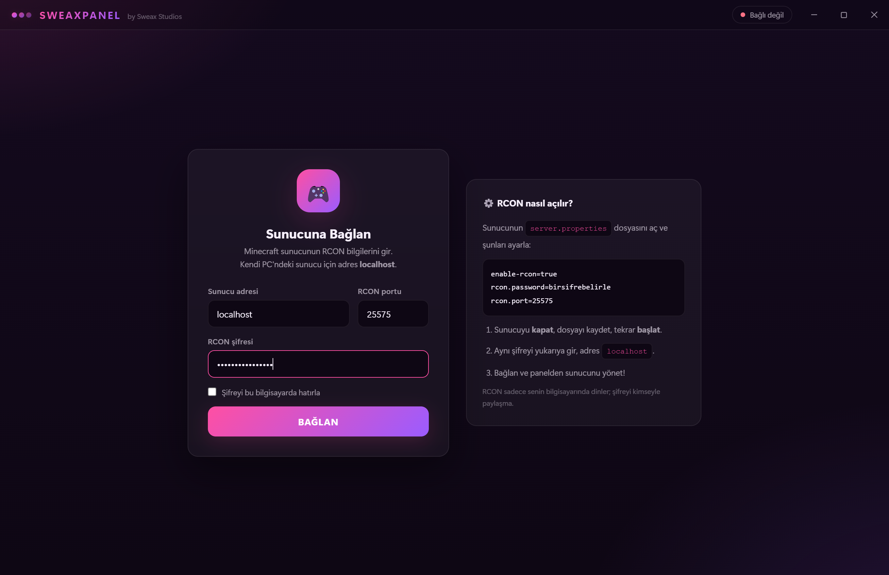</td>
<td width="50%">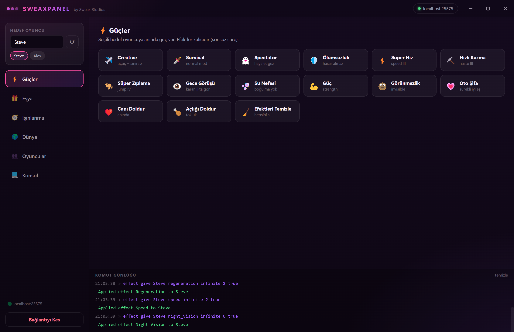</td>
</tr>
<tr>
<td align="center"><sub><b>Bağlan.</b> Adres, RCON portu ve şifre; yanında server.properties satırları.</sub></td>
<td align="center"><sub><b>Güçler.</b> Hedef Steve; sunucunun her yanıtı günlükte.</sub></td>
</tr>
<tr>
<td width="50%">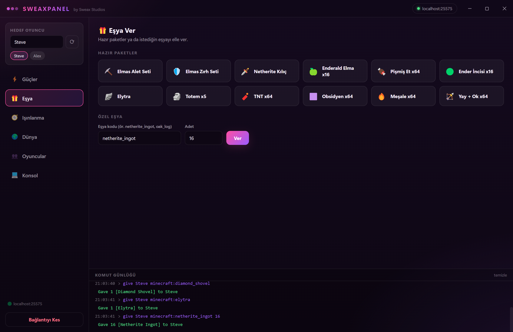</td>
<td width="50%">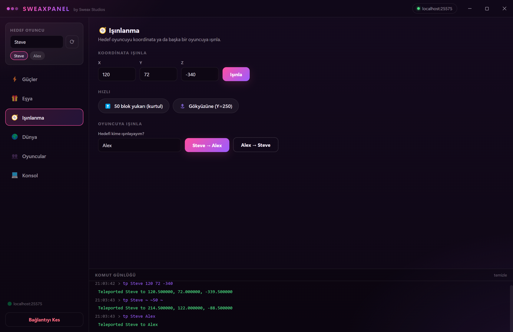</td>
</tr>
<tr>
<td align="center"><sub><b>Eşya.</b> Paketler, sonra özel alandan 16 netherite külçesi.</sub></td>
<td align="center"><sub><b>Işınlanma.</b> Koordinata, 50 blok yukarı, sonra Alex'e.</sub></td>
</tr>
<tr>
<td width="50%">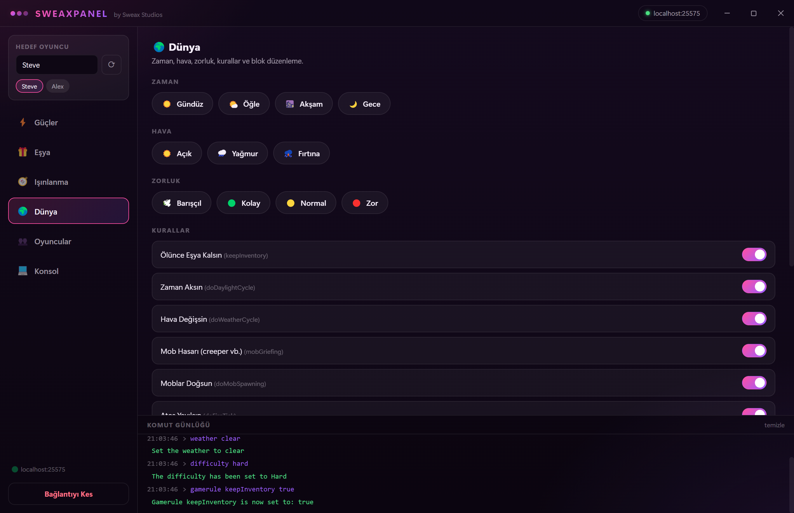</td>
<td width="50%">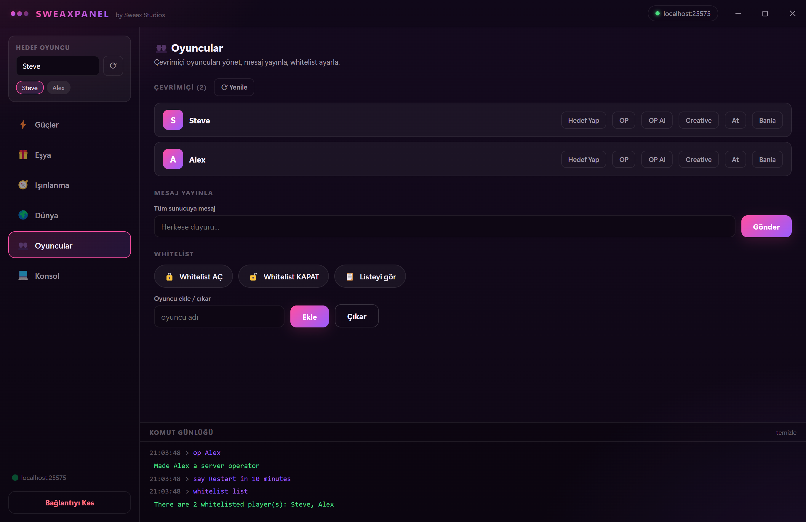</td>
</tr>
<tr>
<td align="center"><sub><b>Dünya.</b> Anahtarlar sunucunun bildirdiği değerleri gösterir.</sub></td>
<td align="center"><sub><b>Oyuncular.</b> Alex'i OP yap, duyuru gönder, whitelist'i listele.</sub></td>
</tr>
<tr>
<td width="50%">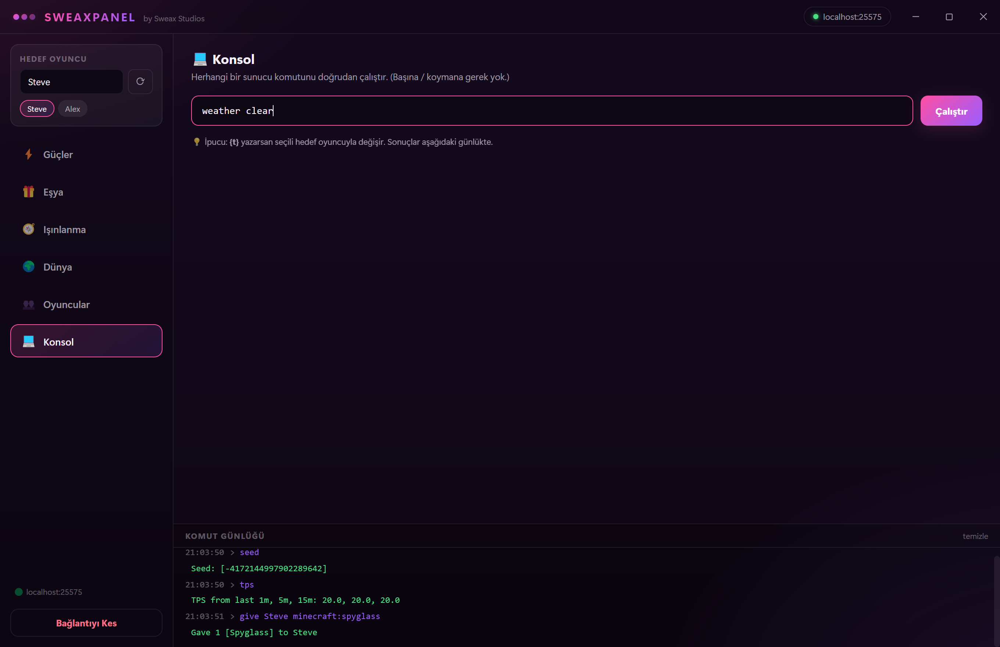</td>
<td width="50%" valign="middle"><sub>Ekran görüntüleri ve kayıt gerçek uygulamaya ait (aynı <code>electron/main.cjs</code>, preload ve RCON istemcisi); uygulamayı Chrome DevTools Protocol üzerinden <a href="tools/media/capture.cjs"><code>tools/media/capture.cjs</code></a> sürüyor. Karşıdaki sunucu <a href="tools/media/fake-rcon-server.cjs"><code>tools/media/fake-rcon-server.cjs</code></a>: RCON konuşan ve bir Paper sunucusu gibi yanıt veren küçük bir yedek. Bu yüzden görüntülerde gerçek sunucu ya da oyuncu verisi yok; Steve ve Alex örnek isimler.</sub></td>
</tr>
<tr>
<td align="center"><sub><b>Konsol.</b> Son komutta <code>{t}</code> Steve oldu.</sub></td>
<td></td>
</tr>
</table>

<br>

## Bir düğmeye basınca ne olur

<picture>
  <source media="(prefers-color-scheme: dark)" srcset="docs/art/architecture-tr-dark.svg">
  
</picture>

Pencerenin Node erişimi yok (`contextIsolation` açık, `nodeIntegration` kapalı). Yalnızca preload betiğinin `window.sweax` olarak açtığı sekiz işlevi çağırabilir: bağlan, komut, bağlantıyı kes, durum, ayarları oku ve kaydet, pencere düğmeleri ve bağlantı koptuğunda gelen bildirim. Ana süreç tek bir RCON bağlantısı tutar. Bağlanma 8 saniyede, her komut 6 saniyede zaman aşımına uğrar. Yanıtlardaki renk kodları (`§a`, `§6`…) gösterilmeden önce silinir.

<picture>
  <source media="(prefers-color-scheme: dark)" srcset="docs/art/packet-tr-dark.svg">
  
</picture>

RCON, Source RCON protokolüdür. TCP bağlantısı açılınca istemci şifreyle bir giriş paketi (tür 3) gönderir; sunucu aynı istek numarasıyla, şifre yanlışsa −1 numarasıyla yanıt verir. Sonraki her komut tür 2 paketidir, yanıt da aynı numaralı tür 0 paketi. [`electron/rcon.cjs`](electron/rcon.cjs) bu çerçeveleri oluşturur, birkaç TCP okumasına bölünerek gelen yanıtları birleştirir ve her yanıtı numarasından komutuyla eşleştirir.

<br>

## Sunucuda RCON'u aç

Sunucuyu durdur, sunucu klasöründeki `server.properties` dosyasını aç, şu üç satırı ayarla ve sunucuyu yeniden başlat:

```properties
enable-rcon=true
rcon.port=25575
rcon.password=buraya-uzun-rastgele-bir-sifre
```

Sonra SweaxPanel'i aç ve şunlarla bağlan:

| Alan | Sunucu aynı bilgisayarda | Sunucu başka yerde |
| --- | --- | --- |
| Sunucu adresi | `localhost` | sunucunun IP'si ya da alan adı |
| RCON portu | `25575` (ya da senin `rcon.port` değerin) | aynı |
| RCON şifresi | senin `rcon.password` değerin | aynı |

> [!WARNING]
> **RCON şifrelenmez.** Şifre ve her komut düz bayt olarak gider; şifreyi bilen herkes sunucunun konsoluna tam erişir. Uzun, rastgele bir şifre kullan. RCON portunu internete açma: modemde port yönlendirme yapma, güvenlik duvarında yalnızca SweaxPanel'i çalıştırdığın bilgisayara izin ver. Sunucu aynı bilgisayardaysa `localhost` ile bağlan.

**Şifreyi hatırla.** İşaretlersen şifre, adres ve portla birlikte `%APPDATA%\SweaxPanel\sweaxpanel-settings.json` dosyasına düz metin olarak kaydedilir. Ortak kullanılan bir bilgisayarda işaretleme. İşaretsizken yalnızca adres ve port kaydedilir.

SweaxPanel başka hiçbir ağ bağlantısı kurmaz: hesap yok, telemetri yok, güncelleme denetimi yok.

<br>

## Kurulum

1. [Son sürümden](https://github.com/Sweax3169/sweaxpanel/releases/latest) **`SweaxPanel-Kurulum-1.0.0.exe`** dosyasını indir. Windows 10 ya da 11, 64 bit.
2. Çalıştır. Tek tıklık bir kurulum: yalnızca senin kullanıcın için `%LOCALAPPDATA%\Programs\SweaxPanel` içine kurar, masaüstüne ve Başlat menüsüne kısayol ekler ve uygulamayı açar.
3. Kurulum dosyası kod imzalı değil, bu yüzden Windows SmartScreen *Windows bilgisayarınızı korudu* diyebilir. **Ek bilgi → Yine de çalıştır**'ı seç.

Kaldırmak için **Ayarlar → Uygulamalar**. `%APPDATA%\SweaxPanel` içindeki kayıtlı bağlantı ayarları sen o klasörü silene kadar durur.

<br>

## Kaynaktan derleme

Node.js 20 ya da üstü, kurulum dosyası için de Windows gerekir.

```powershell
git clone https://github.com/Sweax3169/sweaxpanel.git
cd sweaxpanel
npm ci

npm run dev               # arayüz tarayıcıda, http://localhost:5210, sahte RCON ile (src/mockApi.js)
npm run build:renderer    # arayüzü dist/ içine derle
npm start                 # Electron'da çalıştır (dist/ yüklenir)
npm run dist              # dist/ ve kurulum dosyası release/ içine
```

Electron'u `dist/` yerine Vite geliştirme sunucusuyla çalıştırmak için önce `SWEAXPANEL_DEV_URL` ayarla: `$env:SWEAXPANEL_DEV_URL = "http://localhost:5210"; npm start`.

<details>
<summary><b>Ekran görüntülerini, kaydı ve çizimleri yeniden üretmek</b></summary>

```powershell
npx vite build
npx electron tools/media/capture.cjs    # 25575 portunda yedek sunucuyu açar, docs/media/*.png ve kayıt karelerini kaydeder
node tools/media/encode-film.cjs        # kareler -> docs/media/demo.mp4 ve demo.gif (ffmpeg gerekir)
python tools/art.py                     # docs/art/*.svg (fontTools, brotli, Pillow gerekir)
```

`capture.cjs` uygulamanın kendi `electron/main.cjs` dosyasını yükler, pencereyi odak almadan ekranın dışında tutar ve uygulamanın veri klasörünü geçici bir klasöre yönlendirir; kurulu bir uygulamanın ayarlarını okumaz, değiştirmez.
</details>

<br>

## Proje yapısı

```
electron/
  main.cjs          pencere, IPC işleyicileri, ayar dosyası
  preload.cjs       window.sweax köprüsü
  rcon.cjs          Source RCON istemcisi (yalnızca Node net)
src/
  App.jsx           bağlantı durumu, komut çalıştırıcı, günlük
  commands.js       her düğme ve gönderdiği komutlar ({t} = hedef)
  components/       ConnectScreen, Sidebar, Sections (altı sekme), LogPanel, TitleBar
  mockApi.js        tarayıcıda npm run dev için sahte window.sweax
build/              uygulama ikonu ve üreticisi (make-icon.mjs)
docs/               site (GitHub Pages), ekran görüntüleri, çizimler, yazı tipleri
tools/              art.py, media/capture.cjs, media/fake-rcon-server.cjs, media/encode-film.cjs
```

<br>

## Sorular

<details>
<summary><b>Başkasının sunucusunda kullanabilir miyim?</b></summary>

Yalnızca o sunucunun RCON şifresiyle; o şifre de yalnızca sunucuyu çalıştıranlarda olur. SweaxPanel sunucunun kendi uzak konsoluyla konuşur, oyun istemcisinde hiçbir şey yapmaz.
</details>

<details>
<summary><b>Hangi sunucular ve sürümler çalışır?</b></summary>

RCON'u açık Java Edition sunucuları: vanilla ve onun üzerine kurulu Paper, Spigot, Fabric, Forge gibi sunucular. Paper 1.21.4'e karşı test edildi. Güçler sekmesi <code>effect … infinite</code> kullanır; bu Java Edition 1.19.4 ve üstünü ister. Daha eski sürümlerde sunucu o düğmeleri reddeder, gerisi çalışmaya devam eder. Bedrock Dedicated Server'da RCON yok, orada çalışmaz.
</details>

<details>
<summary><b>Barındırma firmam bir web paneli veriyor. Onunla çalışır mı?</b></summary>

Firman RCON'u açmana izin veriyor ve sana adres, port ve şifre veriyorsa onları gir. Bazı firmalar RCON'u hiç açmaz.
</details>

<details>
<summary><b>Bağlanamıyorum. Neye bakmalıyım?</b></summary>

SweaxPanel nedenini yazar: sunucuya ulaşılamadı (sunucu kapalı ya da port yanlış), bağlantı zaman aşımına uğradı (adres yanlış ya da güvenlik duvarı), adres bulunamadı, şifre yanlış ya da sunucu bağlantıyı kapattı (RCON açık değil). <code>server.properties</code> değiştikten sonra sunucunun yeniden başlatılması gerekir.
</details>

<details>
<summary><b>macOS ya da Linux?</b></summary>

Yalnızca Windows kurulum dosyası derleniyor ve test ediliyor.
</details>

<br>

## Emeği geçenler

[Electron](https://www.electronjs.org/), [React](https://react.dev/) ve [Vite](https://vite.dev/) ile yapıldı, [electron-builder](https://www.electron.build/) ile paketlendi. Kablodaki biçim, Minecraft sunucularının da kullandığı Valve'ın [Source RCON protokolü](https://developer.valvesoftware.com/wiki/Source_RCON_Protocol). Site ve çizimlerde [Instrument Sans](https://github.com/Instrument/instrument-sans) ve [Martian Mono](https://github.com/evilmartians/mono) kullanıldı. Ayrıntılar [THIRD_PARTY_NOTICES.md](THIRD_PARTY_NOTICES.md) içinde.

MIT lisanslı. © 2026 Sweax Studios.

<sub>SweaxPanel resmî bir Minecraft ürünü değildir; Mojang ya da Microsoft tarafından onaylanmamıştır ve onlarla bağlantılı değildir.</sub>
