<a href="https://sweax3169.github.io/sweaxbeacon/">
  <picture>
    <source media="(prefers-color-scheme: dark)" srcset="docs/art/banner-tr-dark.svg">
    
  </picture>
</a>

<p align="center">
  <a href="https://github.com/Sweax3169/sweaxbeacon/releases/latest"><b>Windows için indir</b></a>
  &nbsp;&nbsp;·&nbsp;&nbsp;
  <a href="https://sweax3169.github.io/sweaxbeacon/">Web sitesi, tıklanabilir sürümüyle</a>
  &nbsp;&nbsp;·&nbsp;&nbsp;
  <a href="README.md">English</a>
</p>

<p align="center">
  <a href="https://github.com/Sweax3169/sweaxbeacon/releases/latest"></a>
  
  
  
  <a href="LICENSE"></a>
</p>

<br>

<p align="center">
  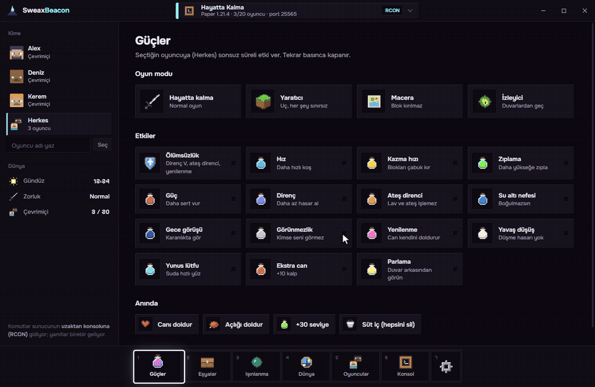
</p>
<p align="center"><sub>Uygulamanın arayüzü, yerleşik demo dünyalarında (web sitesindekilerle aynı); gerçek bir sunucu ya da oyuncu görünmüyor. <a href="docs/media/tour.mp4">MP4</a></sub></p>

<br>

## Nedir

SweaxBeacon, Minecraft Java oynayanlar için bir Windows uygulaması. Bir oyuncu seç, bir düğmeye bas: Yaratıcı mod, sen kapatana kadar süren bir etki, bir elmas alet seti, kaydettiğin bir yere ışınlanma, gündüz, Ölünce eşyalar kalsın. Kendi çalıştırdığın sunucuda, RCON şifresine sahip olduğun başka bir sunucuda, LAN dünyasında ve tek oyunculuda çalışır.

Hesap yok, giriş yok, bağlantı ekranı yok. Açıldığında bilgisayardaki Minecraft'ı arar ve bulduğuna bağlanır. Başka hiçbir yol yoksa bir şey ister; o da tek düğmedir.

- **Dünyalarını kendisi bulur.** Çalışan sunucuları Java sürecinden ve klasöründen, diskteki sunucu klasörlerini `server.properties` dosyasından, açık Minecraft penceresini hangi başlatıcı açmış olursa olsun oyunun kendi komut satırından bulur.
- **Tek oyunculu çalışır.** Tek oyunculuda uzaktan konsol yok; SweaxBeacon komutları oyunun sohbetine yazar. Mesajları yalnızca Minecraft penceresine gönderir, klavyeyi hiç kullanmaz; oyun duraklatma menüsüyle arka planda kalır. Oyunun yanıtları kendi günlüğünden okunur.
- **Sunucuyu senin yerine hazırlar.** RCON kapalı mı? Tek düğme `server.properties` dosyasına rastgele bir şifreyle yazar. Sunucu kapalı mı? Tek düğme, başlatma dosyası nasıl açıyorsa öyle, kendi konsol penceresinde açar.
- **Dünyayı olduğu gibi gösterir.** Açık etkiler parlar, geçerli oyun modu işaretlenir; saat, zorluk ve oyun kuralları sunucudan ya da dünyanın `level.dat` dosyasından okunur.

<br>

## Her dünyaya giriş yolu, senin için seçilir

| Bu bilgisayarda ne var | SweaxBeacon nasıl girer | Sen ne yaparsın |
| --- | --- | --- |
| RCON'u açık bir sunucu | uzaktan konsolu; şifre `server.properties` dosyasından okunur | hiçbir şey |
| RCON'u kapalı, çalışan bir sunucu | `enable-rcon`, boş bir `rcon.port` ve rastgele bir `rcon.password` yazar | sunucuyu bir kez yeniden başlatırsın |
| Çalışmayan bir sunucu klasörü | RCON'u hazırlayıp kendi penceresinde başlatır | ilk seferde Mojang'ın EULA'sını kabul edersin |
| Tek oyunculu dünyada Minecraft | oyunun sohbeti; arka plandaki pencereye yazılır | hileler açık: **Esc → LAN'a Aç → Hilelere İzin Ver: AÇIK** |
| LAN dünyasında ya da operatör olduğun sunucuda Minecraft | oyunun sohbeti | hiçbir şey |
| Başka bir bilgisayardaki ya da kiralık sunucu | bir kez girdiğin adres, port ve şifreyle RCON | bir form doldurursun |

Minecraft açık ve bu bilgisayardaki RCON'lu bir sunucuya bağlıysa SweaxBeacon o sunucunun RCON'unu kullanır; her oyuncu için birebir yanıt verir. Son kullandığın dünya bir dahaki açılışta yine açılır.

<br>

## Bağlantı ekranı yerine tek düğme

<p align="center">
  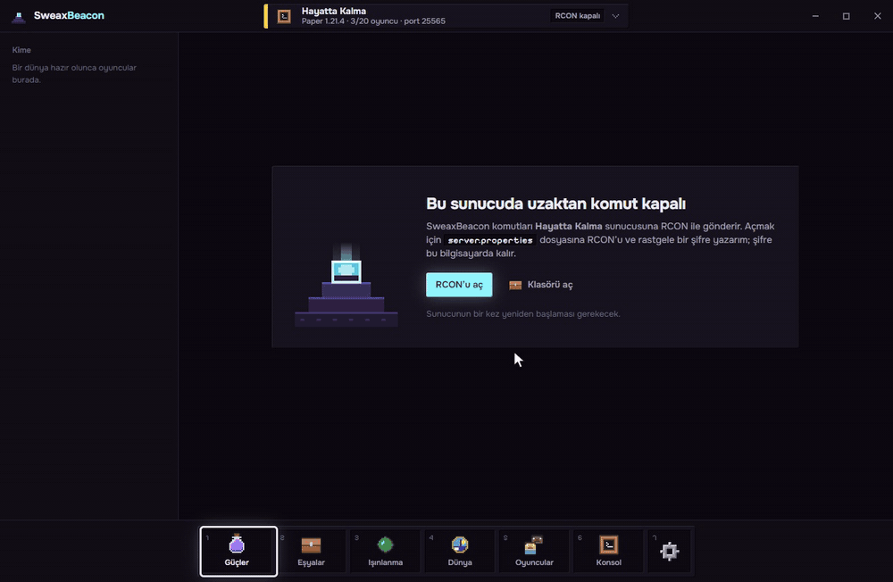
</p>

<table>
<tr>
<td width="33%" valign="top">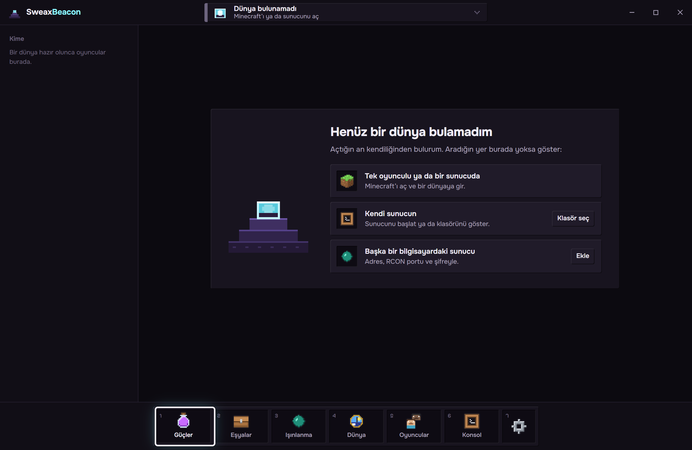<br><b>Hiçbir şey bulunamadı.</b> Minecraft'ı ya da sunucunu aç, kendiliğinden görünür; başka bir yerdeki sunucu klasörü bir kez gösterilir, başka bir bilgisayardaki sunucu RCON şifresiyle eklenir.</td>
<td width="33%" valign="top">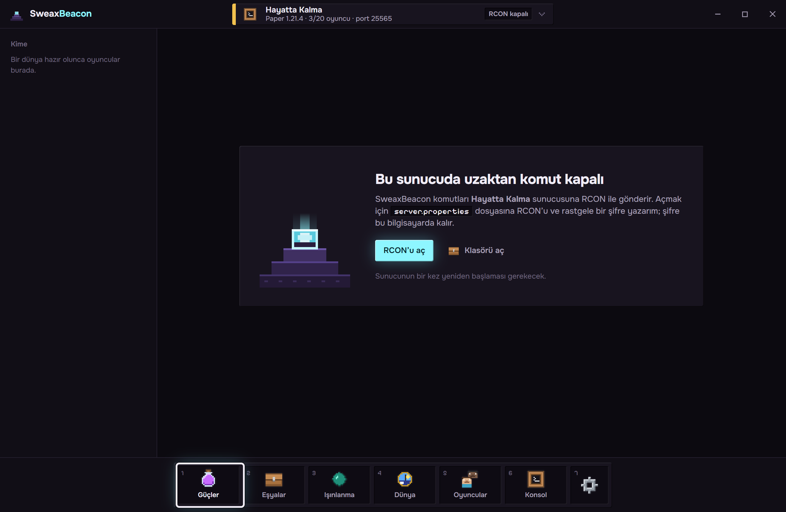<br><b>RCON kapalı.</b> Tek düğme, 24 karakterlik rastgele bir şifre ve boş bir portla <code>server.properties</code> dosyasına yazar. Şifre bilgisayardan çıkmaz.</td>
<td width="33%" valign="top">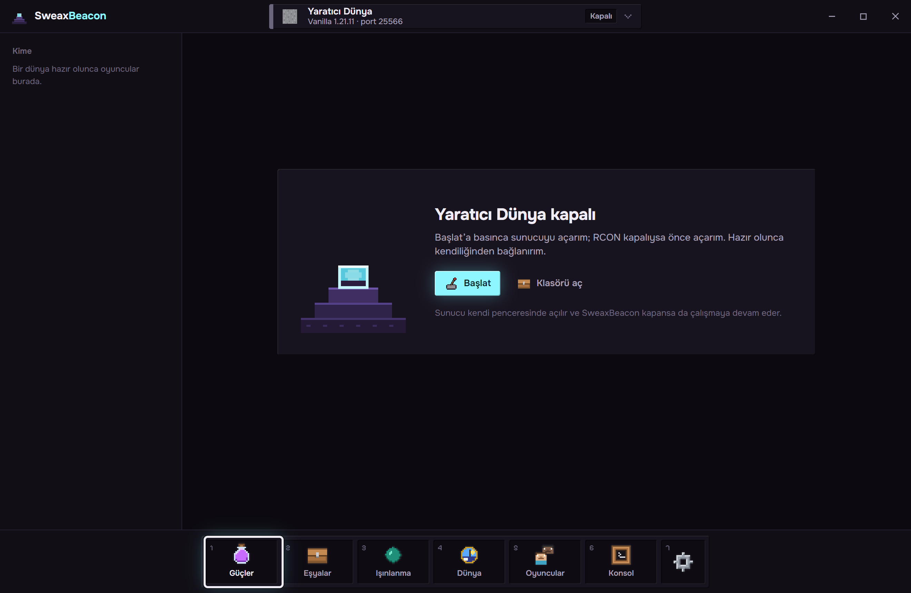<br><b>Sunucu kapalı.</b> Başlat, varsa sunucunun kendi başlatma dosyasını, yoksa jar dosyasını sürümüne uyan bir Java ile, SweaxBeacon kapansa da çalışmaya devam eden bir konsol penceresinde açar.</td>
</tr>
</table>

<br>

## Tek oyunculu

<p align="center">
  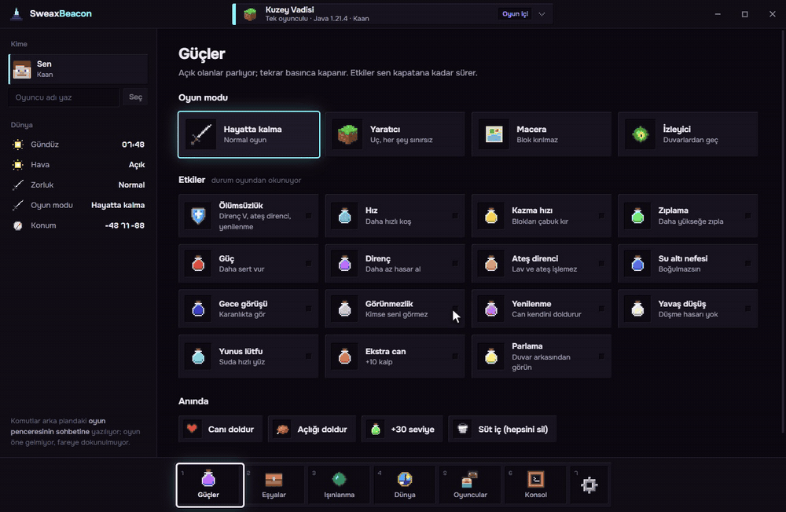
</p>

Minecraft açıkken SweaxBeacon içinde olduğun dünyayı adıyla, yanında *Oyun içi* yazısıyla gösterir. Düğmeler sunucudakiyle aynıdır. Her komut, oyun duraklatma menüsüyle SweaxBeacon'ın arkasında dururken oyunun sohbetine yazılır:

<picture>
  <source media="(prefers-color-scheme: dark)" srcset="docs/art/sequence-tr-dark.svg">
  
</picture>

- **Yalnızca oyun penceresi duyar.** Tuşlar ve metin, Minecraft penceresine gönderilen pencere mesajlarıdır ([`native/SweaxHelper.cs`](native/SweaxHelper.cs)). Hiçbiri sistem klavyesinden geçmez; başka bir pencerede yazdığın şey bozulmaz, oyun öne gelmez, fare hiç oynamaz.
- **Önce ve sonra kontrol eder.** Yeni yüklenen bir dünyanın duraklatma menüsünü bir kez göstermesini bekler, sohbet tuşunu `options.txt` dosyasından okur (her klavye tuşu olur) ve oyun yanıt vermezse paketi durdurur. Tek oyunculuda, pencereyi bırakmadan önce duraklatma menüsünün geri geldiğini günlükteki `Saving and pausing game...` satırından doğrular.
- **Yanıtlar senin dilinde.** Yanıtlar oyunun `logs/latest.log` dosyasından gelir ve senin oyununun dil dosyasından kurulan kalıplarla eşleştirilir; *Bilinmeyen ya da eksik komut* Türkçe de tanınır ve SweaxBeacon hilelerin nasıl açılacağını söyler.
- **Dünyanın durumu kayıttan okunur.** Minecraft her duraklamada `level.dat` dosyasını yazar; her paket de böyle biter. Uygulama oyuncunun oyun modunu, etkilerini ve konumunu, saati, havayı, zorluğu ve oyun kurallarını buradan okur.

Oyunda iki şey gerekir: hileler (**Esc → LAN'a Aç → Hilelere İzin Ver: AÇIK → LAN Dünyası Başlat**, ya da hileli oluşturulmuş bir dünya) ve <kbd>F3</kbd>+<kbd>P</kbd> ile kapatmadıysan zaten açık olan *Odak kaybında duraklat*. Biri eksikse SweaxBeacon söyler.

<br>

## Neler yapabilirsin

<table>
<tr>
<td width="33%" valign="top">
<picture><source media="(prefers-color-scheme: dark)" srcset="docs/art/tile-powers-dark.svg"></picture>
<h3>Güçler</h3>
<p>Dört oyun modu, Ölümsüzlük (Direnç V, Ateş direnci, Yenilenme III) ve sen kapatana kadar süren on dört etki: Hız, Kazma hızı, Zıplama, Güç, Direnç, Ateş direnci, Su altı nefesi, Gece görüşü, Görünmezlik, Yenilenme, Yavaş düşüş, Yunus lütfu, Ekstra can, Parlama. Tekrar basınca kapanır. Üstüne tam can, tam tokluk, 30 seviye ve bir kova süt.</p>
</td>
<td width="33%" valign="top">
<picture><source media="(prefers-color-scheme: dark)" srcset="docs/art/tile-items-dark.svg"></picture>
<h3>Eşyalar</h3>
<p>Elmas aletlerden 64 roketli elitraya on altı hazır set, ve Java 1.21.11'in 1.504 eşyasının hepsinde İngilizce ya da oyununun dilinde arama (<i>elmas kılıç</i>, <code>diamond_sword</code>'u bulur); 1, 16, 32, 64 ya da 6.400'e kadar istediğin adet.</p>
</td>
<td width="33%" valign="top">
<picture><source media="(prefers-color-scheme: dark)" srcset="docs/art/tile-teleport-dark.svg"></picture>
<h3>Işınlanma</h3>
<p>Durduğun yeri bir adla kaydet, tek tıkla doğru boyutta geri dön. Koordinata, dünyanın doğuş noktasına, mağarada sıkıştığında yüzeye, 50 blok yukarı, başka bir oyuncunun yanına git ya da bir oyuncuyu yanına getir.</p>
</td>
</tr>
<tr>
<td width="33%" valign="top">
<picture><source media="(prefers-color-scheme: dark)" srcset="docs/art/tile-world-dark.svg"></picture>
<h3>Dünya</h3>
<p>Sabah, öğle, akşam ve geceli bir gün kadranı; açık, yağmur ya da fırtına; dört zorluk; gerçek durumunu gösteren anahtarlarla on iki oyun kuralı; "burası bir köşe" düğmeli doldurma aracı. Kural adları sürüme uyar: 1.21.11 öncesi <code>keepInventory</code>, 1.21.11 ve sonrası <code>keep_inventory</code>.</p>
</td>
<td width="33%" valign="top">
<picture><source media="(prefers-color-scheme: dark)" srcset="docs/art/tile-players-dark.svg"></picture>
<h3>Oyuncular</h3>
<p>Çevrimiçi herkes, adından üretilen piksel bir yüzle. Düğmelerin kime gideceğini seç (bir oyuncu, herkes ya da yazdığın bir ad), operatör yap, at, yasakla, herkese mesaj gönder, beyaz listeyi yönet.</p>
</td>
<td width="33%" valign="top">
<picture><source media="(prefers-color-scheme: dark)" srcset="docs/art/tile-console-dark.svg"></picture>
<h3>Konsol</h3>
<p>Her komut; <kbd>↑</kbd> <kbd>↓</kbd> ile geçmiş, <code>{t}</code> seçili oyuncu yerine. Her düğmenin komutları ve her yanıt saatiyle burada listelenir; son birkaçı oyun sohbeti gibi sol altta da görünür.</p>
</td>
</tr>
</table>

<br>

## Ekranlar

<p align="center">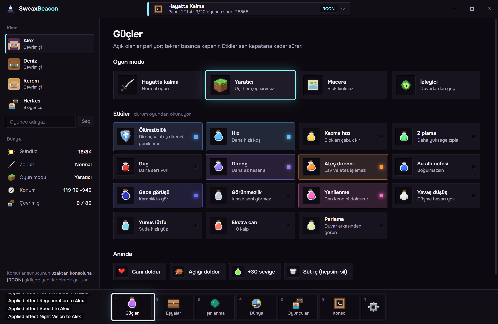</p>

<table>
<tr>
<td width="50%">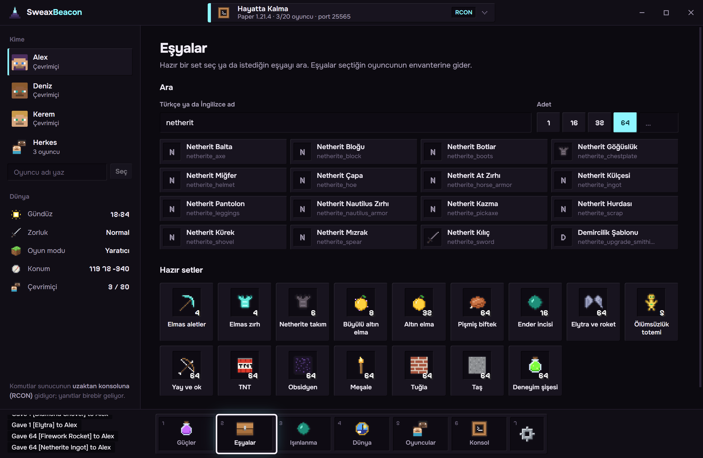</td>
<td width="50%">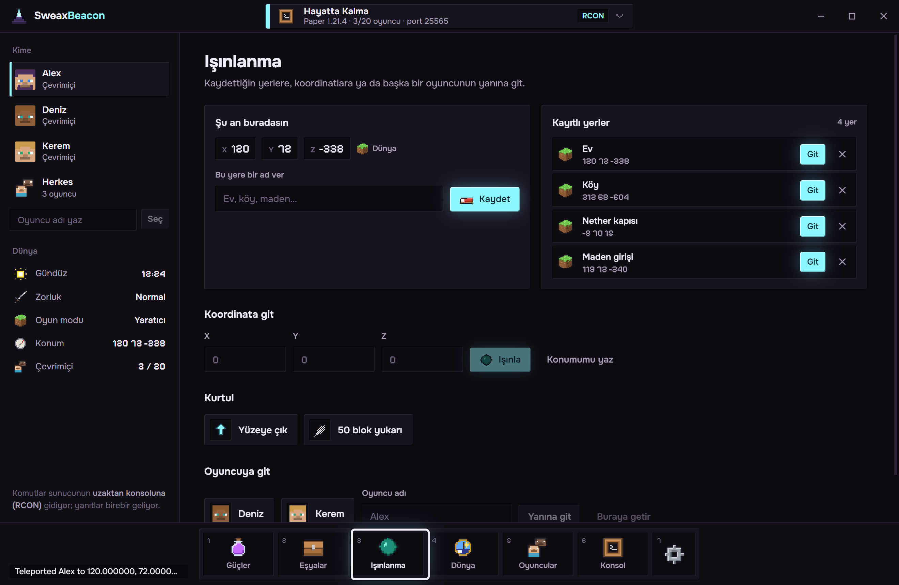</td>
</tr>
<tr>
<td>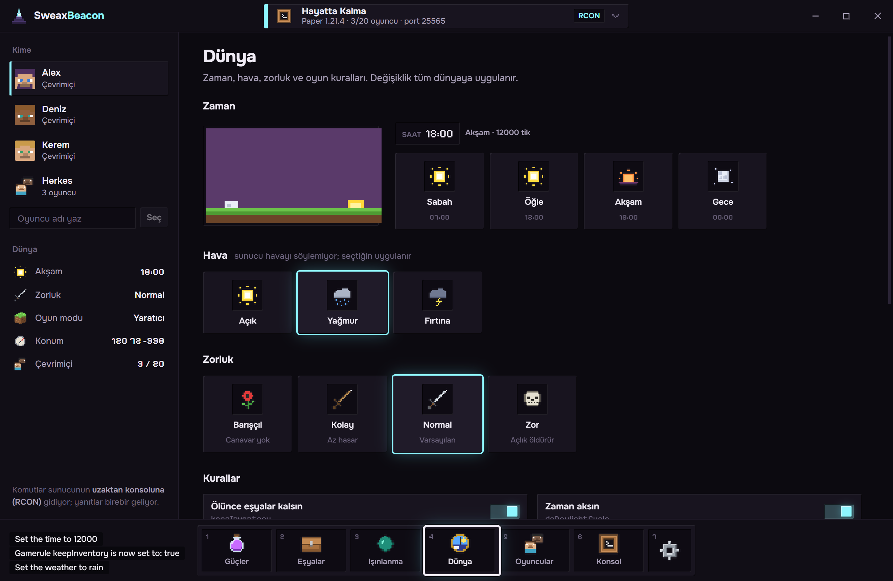</td>
<td>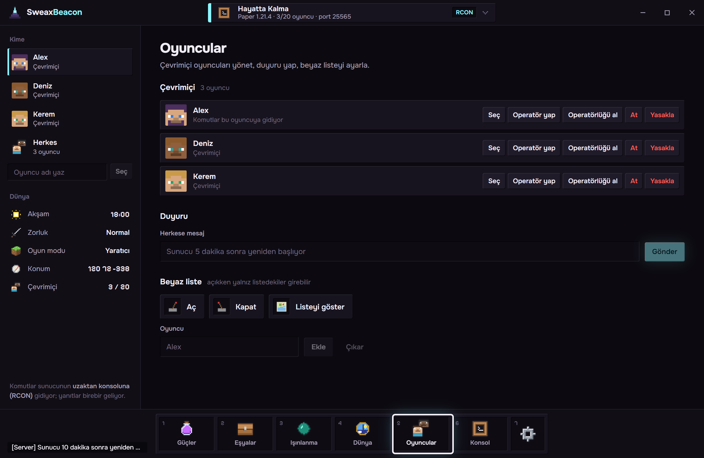</td>
</tr>
<tr>
<td>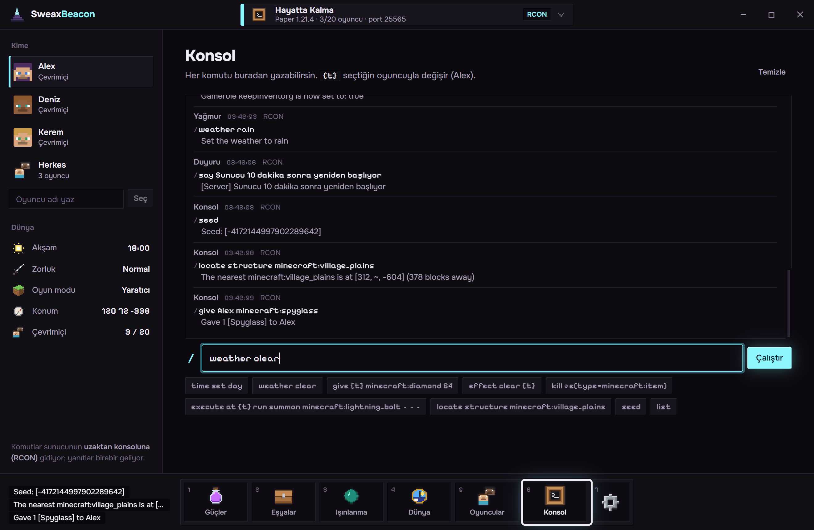</td>
<td>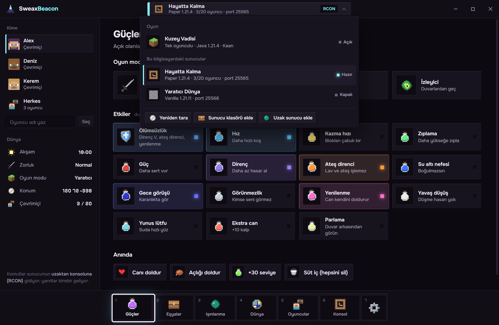</td>
</tr>
<tr>
<td>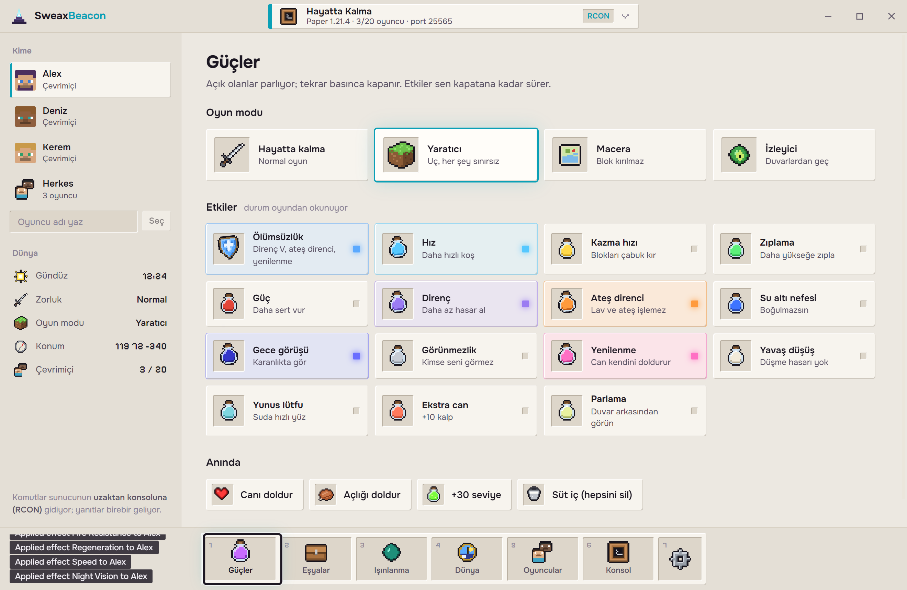</td>
<td>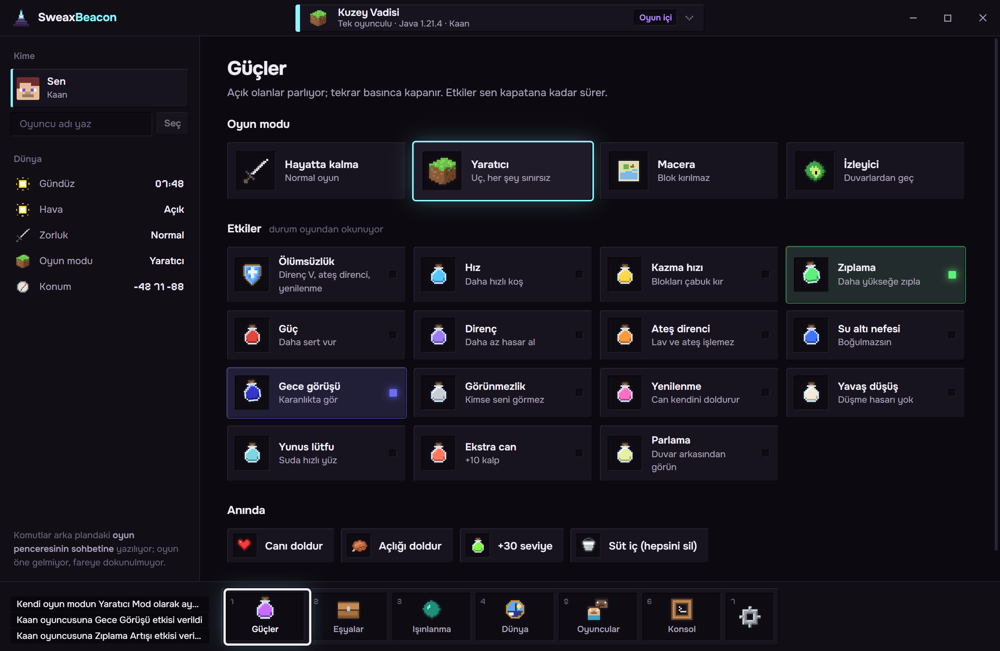</td>
</tr>
</table>

Görünüş, Minecraft'ta çevresindeki oyunculara güç veren fener bloğundan geliyor: yüzeyler üst kenarı açık, alt kenarı koyu bloklar; eşya yuvaları envanterdeki gibi içe basık; tek vurgu rengi fener ışığı; her etki kendi iksir rengini taşır. Sayfalar bir hotbar'dan seçilir (<kbd>1</kbd>–<kbd>7</kbd> tuşları); seçim çerçevesi yuvaya yaylanarak geçer ve sayfanın adı, oyunun eşya adını gösterdiği gibi bir an üstünde görünür. Bütün ikonlar [`tools/pixel_icons.py`](tools/pixel_icons.py) ile çizildi; oyundan hiçbir şey alınmadı. İki tema: Obsidyen ve Kuvars, ya da Windows'a uyar.

<br>

## Nasıl çalışır

<picture>
  <source media="(prefers-color-scheme: dark)" srcset="docs/art/architecture-tr-dark.svg">
  
</picture>

**Dünyaları bulmak.** Birkaç saniyede bir [`electron/mc/discover.cjs`](electron/mc/discover.cjs) yardımcı programdan her `java.exe` ve `javaw.exe` sürecini komut satırı ve çalışma klasörüyle ister (süreç ortam bloğundan okunur, yönetici izni gerekmez). Klasöründe `server.properties` olan süreç bir sunucudur; dinlediği portlar `netstat`'tan, oyun portuna yapılan Sunucu Listesi Ping'i ile de sürüm, oyuncu sayısı ve simgesi gelir. `net.minecraft.client.main.Main` ile başlatılan bir süreç, bir Fabric, Quilt, Forge ya da NeoForge istemcisi, ya da Prism gibi bir başlatıcı bir oyundur; `--gameDir`, `--username` ve `--version` komut satırından, `options.txt` klasöründen okunur. Çalışmayan sunucu klasörleri, uygulama açılırken olağan yerlerde (Masaüstü, Belgeler, İndirilenler ve her sürücünün üst kısmı) kısa bir taramayla bulunur ve hatırlanır.

**RCON.** [`electron/mc/rcon.cjs`](electron/mc/rcon.cjs), yalnızca Node'un `net` modülüyle yazılmış Source RCON protokolüdür. Minecraft, tek okumada birden fazla paket gelen bağlantıyı kapatır; bu yüzden her paket ayrı gider. Sunucunun 4 KB'lık paketlere böldüğü uzun yanıtlar, ilk parçadan sonra bilinmeyen türde bir paket gönderip sunucunun buna verdiği "Unknown request" yanıtı beklenerek birleştirilir.

**Oyun penceresi.** Adımları [`electron/mc/links.cjs`](electron/mc/links.cjs) belirler ve aralarında `latest.log`'u izler; mesajları Windows'la gelen derleyiciyle derlenmiş 12 KB'lık bir C# programı olan [`native/SweaxHelper.cs`](native/SweaxHelper.cs) gönderir. Açık tek oyunculu dünya, oyunun `session.lock` dosyasını tuttuğu dünyadır; `level.dat` dosyası [`electron/mc/nbt.cjs`](electron/mc/nbt.cjs) içindeki NBT okuyucuyla okunur.

**Pencere.** Node erişimi olmayan React (`contextIsolation` açık): ana süreçle [`electron/preload.cjs`](electron/preload.cjs) içindeki fonksiyonlar üzerinden konuşur. Uzak sunucuların şifreleri Windows DPAPI ile (Electron `safeStorage`) şifrelenir; yerel sunucular için şifre saklanmaz, kendi `server.properties` dosyalarında kalır.

<br>

## Neyle test edildi

Hepsi bu bilgisayarda çalıştırıldı; betikler [`tools/test/`](tools/test) içinde.

| Ne | Nasıl | Sonuç |
| --- | --- | --- |
| Sunucuyu bulmak, hazırlamak, bağlanmak | RCON'u kapalı Paper 1.21.4'e karşı [`server-test.cjs`](tools/test/server-test.cjs): sürecinden bulundu, RCON açıldı, sunucu durduruldu, SweaxBeacon'ın Başlat'ıyla yeniden açıldı, bağlanıldı, komutlar çalıştı | 20 kontrolün 20'si geçti |
| RCON ayrıntıları | aynı betik: `list`, `difficulty`, `time`, `gamerule`, `weather`, bilinmeyen oyuncu, üç pakete bölünmüş 8.232 karakterlik yanıt, yanlış şifre | geçti |
| Java 1.21.11 oyun kuralı adları | Paper 1.21.11'e RCON; uygulama hiçbir şey sormadan bağlandı, `keep_inventory` adlarını ve durumlarını gösterdi | geçti |
| Sohbet üzerinden tek oyunculu | resmî Minecraft 1.21.4 istemcisinde bir test dünyasında [`chat-link-test.cjs`](tools/test/chat-link-test.cjs): oyun modu, saat, etki, give, oyun kuralı, ışınlanma, list, yanlış komut, sonra `level.dat` okundu; bu sırada fare, fare sınırı ve öndeki pencere 25 ms'de bir ölçüldü | bütün kontroller geçti |
| Hileler kapalı | aynı betik, hilesiz bir dünyada | fark edildi ve açıklandı |
| Uygulamanın tamamı tek oyunculu dünyada | [`app-chat-e2e.cjs`](tools/test/app-chat-e2e.cjs): uygulama çalışan 1.21.4 oyununu kendisi buldu ve bağlandı; düğmelerinden Hız ve öğle uygulandı, `level.dat`'tan geri okundu | bağlandı; sonraki çalıştırmalar engellendi, aşağıya bak |
| Minecraft 1.20.1 | istemciyi, klasörünü, penceresini, ayarlarını ve açık dünyasını bulmak | geçti |

Notlar: yukarıdaki tam sohbet yolu çalıştırmaları, sohbet bağlantısındaki son değişiklikten önce geçti; o değişiklik yalnızca yeni yüklenen bir dünyayı beklemeyi ekliyor. Bu bilgisayardaki sonraki çalıştırmalarda ekran dışında açılan test istemcileri (1.21.4 ve 1.20.1), dünyaya girdikten sonra günlüklerinde bir OpenGL hatasıyla oyunun kendi yükleme ekranında kaldı. SweaxBeacon da tasarlandığı gibi yazmayı reddetti ("dünya hâlâ yükleniyor"); bu yüzden 1.20.1'e yazmak burada gösterilmedi. Tek oyunculu yol, Minecraft'ın varsayılan olarak açık olan *Odak kaybında duraklat* ayarını gerektirir.

<br>

## Kurulum

1. [Son sürümden](https://github.com/Sweax3169/sweaxbeacon/releases/latest) **`SweaxBeacon-Kurulum-2.0.0.exe`** dosyasını indir. Windows 10 ya da 11, 64 bit.
2. Çalıştır. Yalnızca senin kullanıcın için `%LOCALAPPDATA%\Programs\sweaxbeacon` klasörüne kurulur, Masaüstü ve Başlat menüsü kısayolu ekler ve uygulamayı açar.
3. Kurulum dosyası kod imzalı değil; Windows SmartScreen *Windows bilgisayarınızı korudu* diyebilir. **Ek bilgi → Yine de çalıştır**'ı seç.

SweaxPanel 1.x, aynı uygulamanın eski adıdır; **Ayarlar → Uygulamalar**'dan kaldır. Ayarlar `%APPDATA%\SweaxBeacon\settings.json` dosyasında tutulur: hatırlanan sunucu klasörleri, eklediğin sunucular (şifreleri şifreli), kayıtlı yerler ve tema.

<br>

## Kaynaktan derleme

Windows'ta Node.js 20 ya da üstü.

```powershell
git clone https://github.com/Sweax3169/sweaxbeacon.git
cd sweaxbeacon
npm ci

npm run dev            # arayüz, tarayıcıda, demo dünyalarıyla (src/mockApi.js)
npm run build:helper   # native/SweaxHelper.cs → native/bin/sweax-helper.exe
npm run build:renderer # arayüz → dist/
npm start              # gerçek uygulama, Electron'da
npm run dist           # yardımcı + arayüz + kurulum dosyası → release/
```

<details>
<summary><b>Testler, ekran görüntüleri, kayıtlar ve görseller</b></summary>

```powershell
npm run test:server -- --dir=<RCON'u kapalı bir sunucu klasörü> --version=1.21.4
node tools/test/fetch-client.cjs 1.21.4 <klasör>          # sonraki ikisi için Mojang'dan resmî istemci ve sunucu
npm run test:chat -- --client=<klasör> --game=<oyun klasörü> --world=<dünya>
node tools/test/app-chat-e2e.cjs --client=<klasör> --game=<oyun klasörü> --world=<dünya>

npx electron tools/media/capture.cjs --scene=stills       # demo dünyalarında docs/media/*.png
npx electron tools/media/capture.cjs --scene=tour         # ayrıca single, setup; sonra:
node tools/media/encode-film.cjs --name=tour              # docs/media/tour.mp4 ve tour.gif (ffmpeg gerekir)
python tools/pixel_icons.py                               # src/pixel/icons.json
python tools/art.py                                       # docs/art/*.svg (fontTools ve brotli gerekir)
```

Oyun testleri istemciyi odak alamaması için WMI üzerinden başlatır, penceresini bütün ekranların altına taşır ve Windows öndeki pencereyi yeni pencereye verirse hemen geri verir; çekim betiği SweaxBeacon penceresini ekran dışında tutar ve ayarlarını geçici bir klasöre yönlendirir.
</details>

<br>

## Proje yapısı

```
electron/
  main.cjs            pencere, IPC, ayarlar, uzak şifreler için DPAPI
  preload.cjs         window.beacon köprüsü
  sessions.cjs        dünya listesi, birini seçmek, tek bağlantıyı açık tutmak
  mc/discover.cjs     bu bilgisayardaki sunucular ve oyunlar
  mc/links.cjs        RconLink ve ChatLink
  mc/rcon.cjs         Source RCON istemcisi
  mc/game.cjs         tuşlar, dil kalıpları, latest.log, açık dünya, level.dat
  mc/servers.cjs      RCON'u açmak, EULA'yı kabul etmek, Java bulmak, sunucu başlatmak
  mc/props.cjs        server.properties, yerinde düzenleme
  mc/slp.cjs          Sunucu Listesi Ping'i
  mc/nbt.cjs          NBT okuyucu
  mc/names.cjs        oyuncunun kendi dil dosyasından eşya adları
  sys/helper.cjs      sweax-helper.exe ile konuşur
  sys/netstat.cjs     süreç başına dinlenen portlar
native/SweaxHelper.cs süreçler, pencereler ve pencere mesajları (C# 5)
src/
  App.jsx             bağlantılar, canlı durum, komut çalıştırma
  components/         başlık çubuğu ve dünya seçici, sol panel, hotbar, durum kartları, yanıt akışı
  sections/           Güçler, Eşyalar, Işınlanma, Dünya, Oyuncular, Konsol, Ayarlar
  data/catalog.js     her düğme ve gönderdiği komutlar
  pixel/              icons.json ve canvas çizici, üretilen yüzler
  mockApi.js          demo dünyaları
tools/                art.py, pixel_icons.py, build-helper.cjs, media/, test/
docs/                 web sitesi (GitHub Pages), medya, görseller, yazı tipleri
```

<br>

## Gizlilik

SweaxBeacon internete bağlanmaz: hesap yok, telemetri yok, güncelleme denetimi yok. Yalnızca senin seçtiğin ya da bu bilgisayarda çalışan Minecraft sunucularına bağlanır ve bu bilgisayardaki Minecraft kurulumlarının dosyalarını okur (`server.properties`, `options.txt`, `latest.log`, `level.dat`, başlatıcının dil dosyası). Bir sunucu klasörüne ancak bunu söyleyen bir düğmeye bastığında yazar (RCON, EULA).

<br>

## Sorular

<details>
<summary><b>Başkalarının sunucularında çalışır mı?</b></summary>

RCON ile yalnızca o sunucunun şifresiyle. Oyunun sohbetiyle yalnızca sunucunun komut çalıştırmana izin verdiği yerde, yani orada operatörsen. Kendin yazabileceğin komutların aynısını gönderir; oyunu değiştirmez.
</details>

<details>
<summary><b>Hangi sürümler?</b></summary>

Java Edition. Sonsuz süren etkiler <code>effect … infinite</code> kullanır, bu da 1.19.4 ya da sonrasını gerektirir; testler 1.21.4 ve 1.21.11 sunucularında ve bir 1.21.4 istemcisinde çalıştı, bir 1.20.1 istemcisini bulmak da çalıştı. Sunucular: vanilla, Paper, Purpur, Spigot, Fabric, Forge ve NeoForge tanınır. Bedrock'ta ne RCON ne de bu sohbet var; orada çalışmaz.
</details>

<details>
<summary><b>Tek oyunculuda düğmeler bir şey yapmıyor.</b></summary>

Hileler kapalıyken oyun <i>Bilinmeyen ya da eksik komut</i> der; SweaxBeacon da hileleri nasıl açacağını gösterir. Dünyanın hâlâ yüklendiğini söylüyorsa dünyaya girene kadar bekle. F3+P istiyorsa <i>Odak kaybında duraklat</i> kapatılmış.
</details>

<details>
<summary><b>RCON açılınca sunucu neden yeniden başlamalı?</b></summary>

Bir Minecraft sunucusu <code>server.properties</code> dosyasını yalnızca açılırken okur. SweaxBeacon ayarı yazar ve sunucu geri gelir gelmez kendiliğinden bağlanır.
</details>

<details>
<summary><b>RCON güvenli mi?</b></summary>

RCON şifreli değildir; portunu internete açma, modeminde yönlendirme yapma. SweaxBeacon'ın yazdığı şifre 24 rastgele karakterdir.
</details>

<br>

## Emeği geçenler

[Electron](https://www.electronjs.org/), [React](https://react.dev/) ve [Vite](https://vite.dev/) ile yapıldı, [electron-builder](https://www.electron.build/) ile paketlendi. Yazı tipleri: [Onest](https://github.com/simpals/onest) ve [Pixelify Sans](https://github.com/eifetx/Pixelify-Sans). Ayrıntılar [THIRD_PARTY_NOTICES.md](THIRD_PARTY_NOTICES.md) içinde.

MIT lisanslı. © 2026 Sweax Studios.

<sub>SweaxBeacon resmî bir Minecraft ürünü değildir; Mojang ya da Microsoft tarafından onaylanmamıştır ve onlarla bağlantılı değildir.</sub>
